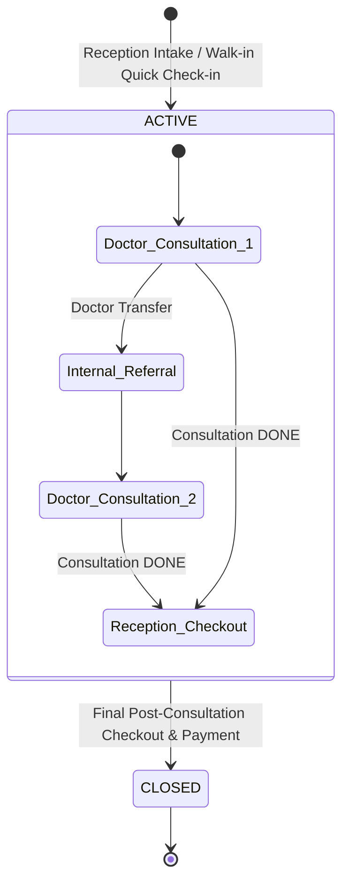

# Reception Post-Consultation Checkout and Consolidated Billing Architecture

## 1. Six-Tier Architectural Entity Separation

To prevent systemic data corruption across internal patient referrals, repeat visits, queue operations, and financial auditing, the platform strictly separates six distinct entities:

```
┌────────────────────────────────────────────────────────────────────────┐
│ 1. PATIENT REGISTRATION (Permanent hospital-wide URN: KH-YYYY-XXXX)    │
│    └── Single master identity shared across all departments.           │
├────────────────────────────────────────────────────────────────────────┤
│ 2. HOSPITAL VISIT (Operational container per patient visit session)    │
│    └── State machine: ACTIVE -> CLOSED. Tracks arrival & discharge.    │
├────────────────────────────────────────────────────────────────────────┤
│ 3. DOCTOR CONSULTATIONS / ENCOUNTERS (One or multiple per visit)       │
│    └── Distinct clinical encounters created per treating doctor.       │
├────────────────────────────────────────────────────────────────────────┤
│ 4. QUEUE TOKENS (Independent per doctor and date)                      │
│    └── Monotonic daily sequence per (doctor_id, date); permanent token.│
├────────────────────────────────────────────────────────────────────────┤
│ 5. BILLING ACCOUNT / VISIT LEDGER (Consolidated charges / debits)      │
│    └── Accumulates doctor fees, clinical procedures, & counter items.  │
├────────────────────────────────────────────────────────────────────────┤
│ 6. PAYMENT TRANSACTIONS (Append-only credits / receipts)               │
│    └── Append-only receipts; Reception exclusive collection authority. │
└────────────────────────────────────────────────────────────────────────┘
```

1. **Patient Registration:** Permanent URN (`KH-YYYY-XXXX`) issued once. Canonical demographics and deduplication preview across phone, name, and address.
2. **Hospital Visit:** The operational visit container. Tracks patient arrival, ongoing clinical services, and discharge. Enforces single active visit concurrency rules per patient.
3. **Doctor Consultation / Encounter:** An individual clinical consultation with a doctor. A single hospital visit can contain *multiple* consultations (e.g., initial intake with General Medicine followed by an internal referral to Ophthalmology).
4. **Queue Token:** Scoped strictly to `(doctor_id, appointment_date)`. Allocated monotonically and permanently consumed. If a patient is transferred from Doctor A to Doctor B, Doctor A's token remains in history, and an independent token is generated in Doctor B's queue.
5. **Billing Account / Visit Ledger:** A unified ledger container for the visit. Both Doctor A's charges, Doctor B's charges, and Reception counter items accumulate on this single ledger as debit entries.
6. **Payment Transactions:** Append-only ledger credits recorded exclusively by `Role.RECEPTION` with payment mode, receipt number, and paise precision.

---

## 2. Visit Identity and Lifecycle State Machine

### Visit States
- **`ACTIVE`**: The patient is on-premises or actively undergoing clinical evaluation/treatment. Consultations, procedures, queue tokens, and dispensed counter products can be appended to this visit's ledger.
- **`CLOSED`**: The patient has completed checkout, settled outstanding dues (or received an authorized waiver), received the consolidated A4 receipt, and is discharged. A `CLOSED` visit is immutable to further automated charges.

### Same-Day Multiple Visits Policy
- **Multiple Visits Allowed:** A patient *can* have more than one distinct hospital visit on the same calendar day (for example, a morning routine consultation followed by an acute evening revisit or emergency intake).
- **Concurrency Invariant:** At any point in time, a patient can have **at most one** `ACTIVE` visit.
  - A new visit cannot be created while an existing visit for that patient remains `ACTIVE`.
  - To open a second visit on the same day, the prior visit must transition to `CLOSED` through the checkout workflow.
  - This prevents double-queue confusion, split bill tracking, and orphaned visits.



---

## 3. Financial Ledger Semantics: Charges (Debits) vs. Payments (Credits)

A critical separation of financial responsibility is enforced between clinical staff and reception cashiers:

### Charges / Debits (Clinical & Counter Items)
- **Consultation Charges:** Triggered when a doctor finalizes a consultation or marks it `DONE`. The system appends a consultation charge to the visit ledger based on the department fee schedule or revisit discount rules.
- **Procedure / Treatment Charges:** Added when doctors or clinical therapists record completed diagnostic tests, minor surgical procedures, or therapies.
- **Counter Products Dispensed:** Added at reception checkout from the active hospital counter catalogue (e.g., prescribed eye drops, physiotherapy braces, ointments).
- **Immutable Clinical Boundary:** Doctor encounters generate *charge entries* (debits), **never** payments. Doctors have zero access to record financial transactions.

### Payments / Credits (Cashier Operations)
- **Reception Exclusivity:** Only users with `Role.RECEPTION` (possessing `payment:create`) can record payment transactions.
- **Append-Only Transactions:** Payments are recorded as individual ledger credits specifying payment mode (`CASH`, `UPI`, `CARD`, `BANK_TRANSFER`), timestamp, cashier user ID, and system receipt number.
- **Outstanding Balance:**
  $$\text{Balance Due} = \sum(\text{Charge Debits}) - \sum(\text{Payment Credits})$$
- A visit transitions to `CLOSED` when $\text{Balance Due} = 0$, or when an administrative waiver/concession is approved by `Role.ADMIN`.

---

## 4. Operational Rules and Refinements

### Rule 1: Multi-Doctor Consultations within One Visit
- If a patient is transferred or internally referred from Doctor A to Doctor B on the same day:
  - The patient retains the **same Hospital Visit container** and **same Visit Ledger**.
  - Doctor A's consultation charge and completed procedures remain debited to the ledger.
  - Doctor B's consultation charge and completed procedures accumulate on the **same ledger**.
  - Reception prints a single, consolidated A4 bill at final checkout reflecting both consultations and all combined services.

### Rule 2: Package Session Deduction Timing
- For multi-session packages (e.g., Physiotherapy Rehab Plans):
  - Session deduction occurs **strictly when the clinician marks the treatment session as completed (`DONE`)**, never merely when the patient arrives or checks in at reception.
  - Merely checking in at reception creates an appointment / queue token, but *zero* package units are deducted at intake.
  - If a patient arrives but the session is interrupted or deferred, no deduction occurs.

### Rule 3: Prescription vs. Counter Product Boundary
- Clinical prescriptions authored by doctors represent medical instructions (for external pharmacies or patient regimen). They **do not** automatically become billable counter line items.
- Only products, ointments, eye drops, or medical remedies **actually dispensed across the reception counter** from the configurable item catalogue are charged on the bill.

### Rule 4: Department-Wise Follow-Up & Validity Windows
- **Physiotherapy:** Managed via multi-session treatment packages (`total_sessions`, `validity_days`, `package_price_paise`). Active package balance is displayed during intake; completed sessions decrement the package balance without generating new consultation charges. Renewals and top-ups are billed at reception.
- **Ophthalmology & General OPD:** Managed via configurable revisit validity windows (e.g., 7 days). Revisit consultations within the window are automatically zero-rated (Rs. 0) or discounted per clinic configuration. Clinical procedures and counter items remain billable.

---

## 5. Printed Document Outputs

| Document | Trigger Point | Content & Layout | Target Printer |
|---|---|---|---|
| **OPD Token / Intake Slip** | Reception Check-in | Patient URN, Name, Age, Gender, Department, Doctor, Date, Token # | Plain sheet / Desk Printer |
| **Consolidated Bill & Receipt** | Post-Consultation Checkout | Bilingual letterhead, URN, Itemized Table (Consultation(s), Procedures, Counter Items), Grand Total, Paid, Balance, Cashier Signature | Epson A4 (100% scale, 12mm margins) |
| **Doctor Prescription Slip** | Consultation Finalization | Bilingual letterhead, Patient demographics, Rx table, Diagnosis, Advice, Follow-up date, Doctor signature | Epson A4 Portrait |
| **Duplicate Receipt** | Admin / Reception Reprint | Identical to Consolidated Receipt, with solid bordered indelible `DUPLICATE` stamp | Epson A4 Portrait |
