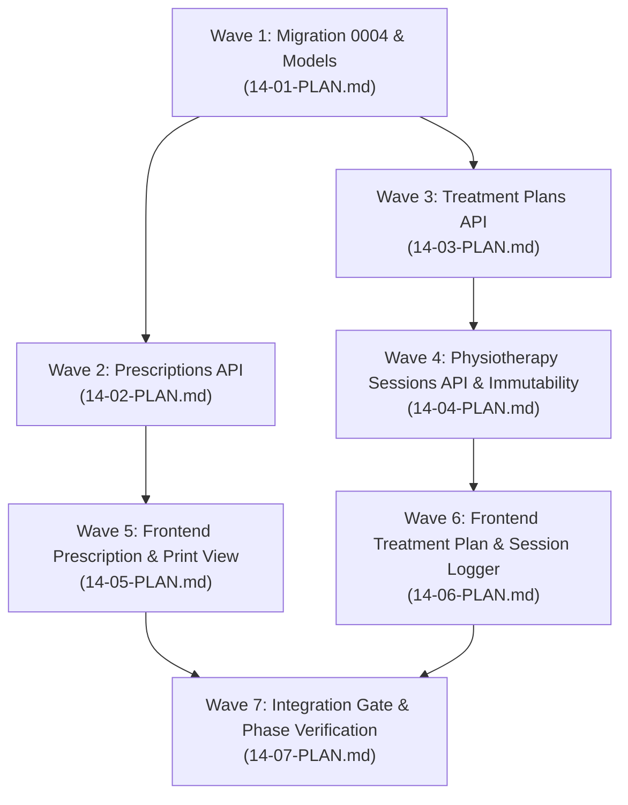

# Phase 14: Execution Plan & Wave Breakdown

**Phase:** 14  
**Title:** Prescriptions, Treatment Plans & Physiotherapy Sessions  
**Branch:** `planning/phase-14-treatment-records`  
**Prerequisites:** Phase 13 verified on `main`  
**Estimated Waves:** 7 Waves  

---

## Wave Breakdown

---

### Plan 14-01: Schema Migration & Core Models
- **Goal:** Implement Alembic migration `0004_prescriptions_and_treatment_records.py` and SQLAlchemy ORM models.
- **Artifacts:**
  - `backend/alembic/versions/0004_prescriptions_and_treatment_records.py`
  - Models: `TreatmentPlan`, `TreatmentSession`, `TreatmentSessionAddendum`, `Prescription`, `PrescriptionItem`.
  - Check constraints: `0 <= vas_score <= 10`, `total_sessions >= 1`, `agreed_price_paise >= 0`.
  - PostgreSQL triggers: `prevent_finalised_treatment_session_tampering` and `sync_treatment_plan_session_progress`.
- **Verification:**
  - `backend/tests/test_treatment_models.py` (model constraints, trigger behavior on tampering attempt, upgrade/downgrade migration test).

---

### Plan 14-02: Prescriptions REST API (`RX-01`)
- **Goal:** Implement endpoints for writing, viewing, and listing patient prescriptions.
- **Artifacts:**
  - Pydantic schemas: `PrescriptionCreate`, `PrescriptionOut`, `PrescriptionItemCreate`, `PrescriptionItemOut`.
  - Router: `backend/src/kalyan_api/routers/prescriptions.py`.
  - Endpoints:
    - `POST /api/prescriptions`: Doctor creates prescription with itemized medicines, dosage, frequency, duration, instructions.
    - `GET /api/prescriptions/{id}`: View specific prescription with items.
    - `GET /api/patients/{id}/prescriptions`: List all prescriptions for a patient in reverse chronological order.
  - Audit logging: `prescription.created`.
- **Verification:**
  - `backend/tests/test_prescriptions_api.py` (validation of item order, duration >= 1, role RBAC permissions matrix).

---

### Plan 14-03: Treatment Plans & Packages REST API (`TRT-01`)
- **Goal:** Implement endpoints for managing treatment packages and resolving the client registration form gap (`OQ-13`).
- **Artifacts:**
  - Pydantic schemas: `TreatmentPlanCreate`, `TreatmentPlanUpdate`, `TreatmentPlanOut`.
  - Router: `backend/src/kalyan_api/routers/treatment_plans.py`.
  - Endpoints:
    - `POST /api/treatment-plans`: Create plan with `plan_name`, `condition_diagnosis`, `referred_by`, `total_sessions`, `agreed_price_paise`.
    - `GET /api/treatment-plans/{id}`: Retrieve plan and current progress (`completed_sessions`).
    - `GET /api/patients/{id}/treatment-plans`: List all plans for a patient.
    - `PATCH /api/treatment-plans/{id}`: Modify or cancel plan with `version_id` optimistic concurrency and mandatory cancellation reason.
  - Audit logging: `treatment_plan.created`, `treatment_plan.updated`, `treatment_plan.cancelled`.
- **Verification:**
  - `backend/tests/test_treatment_plans_api.py` (optimistic locking 409, cancellation validation, session limit checks).

---

### Plan 14-04: Physiotherapy Sessions & Addenda REST API (`TRT-02`, `TRT-03`)
- **Goal:** Implement session logging with atomic sequence allocation, VAS pain scoring, immutability locking, and addenda recording.
- **Artifacts:**
  - Service: `backend/src/kalyan_api/services/session_service.py` (concurrency-safe session sequencing using `FOR UPDATE` lock on `treatment_plans`).
  - Router: `backend/src/kalyan_api/routers/treatment_sessions.py`.
  - Endpoints:
    - `POST /api/treatment-plans/{id}/sessions`: Record therapy session with VAS score (0–10), modalities list, clinical notes.
    - `GET /api/treatment-plans/{id}/sessions`: List chronological sessions with VAS history.
    - `POST /api/treatment-sessions/{id}/addenda`: Append dated addenda to finalized session.
  - Audit logging: `treatment_session.created`, `treatment_session.addendum_added`.
- **Verification:**
  - `backend/tests/test_treatment_sessions_api.py` (VAS range check 0..10, 400 on edit/delete attempts on finalized session, addenda ordering).
  - `backend/tests/test_session_concurrency.py` (parallel racing session logging produces distinct, ordered session numbers).

---

### Plan 14-05: Frontend Prescriptions Workspace & Bilingual Print View (`RX-01`)
- **Goal:** Build doctor prescription authoring interface and bilingual printable prescription view matching client hospital slip format.
- **Artifacts:**
  - `frontend/src/pages/PrescriptionWorkspace.tsx`: Dynamic multi-item prescription form (medicine lookup/input, dosage, frequency, duration, instructions, advice).
  - `frontend/src/components/PrescriptionPrint.tsx`: A4 printable prescription component with bilingual clinic header, patient demographic banner, Rx symbol, English medication table, and static Hindi labels using bundled Devanagari typography.
- **Verification:**
  - `frontend/src/pages/__tests__/prescription-workspace.test.tsx` (item add/remove, form validation, print trigger).

---

### Plan 14-06: Frontend Treatment Plan & Session Logger UI (`TRT-01`, `TRT-02`, `TRT-03`)
- **Goal:** Build treatment package management and interactive physiotherapy session logger.
- **Artifacts:**
  - `frontend/src/pages/TreatmentPlanWorkspace.tsx`: Treatment plan overview, progress gauge (e.g. Session 4 of 10), and package status controls.
  - `frontend/src/components/SessionLoggerModal.tsx`: Interactive session modal with VAS pain score slider (0–10) with color feedback, checkboxes for physiotherapy modalities (IFT, Ultrasound, Traction, etc.), and clinical note input.
  - `frontend/src/components/SessionAddendumModal.tsx`: Addendum append form for past sessions.
  - `frontend/src/components/VasTrendChart.tsx`: Pain recovery visualizer showing VAS scores across sessions 1..N.
- **Verification:**
  - `frontend/src/pages/__tests__/treatment-plan-workspace.test.tsx` (session submission, VAS slider interaction, addenda modal, plan completion UI).

---

### Plan 14-07: Phase 14 Integration Gate & Quality Verification
- **Goal:** Execute full Phase 14 integration test suite, assert $\ge 85\%$ backend coverage, verify zero legacy diffs, and document manual verification checkpoints.
- **Artifacts:**
  - `backend/tests/test_phase14_gate.py`: End-to-end integration test of prescription creation, plan allocation, parallel session logging, immutability tamper defense, and addenda retrieval.
  - `.planning/phases/14-prescriptions-treatment-plans-sessions/14-VALIDATION.md`
  - `.planning/phases/14-prescriptions-treatment-plans-sessions/14-MANUAL-CHECKS.md`
  - `.planning/phases/14-prescriptions-treatment-plans-sessions/14-SUMMARY.md`
- **Verification:**
  - Pytest full suite with `--cov=kalyan_api --cov-fail-under=85`.
  - Ruff check 0 errors.
  - Frontend typecheck (`tsc -b`), oxlint, and vitest suite.
  - Legacy isolation check: `git diff --stat 43ab9c4 -- app tests ...`.

