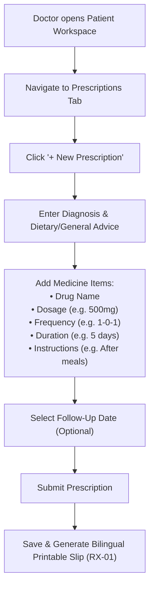
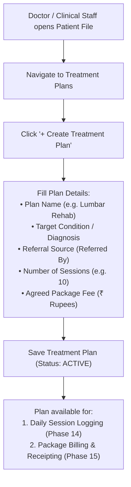
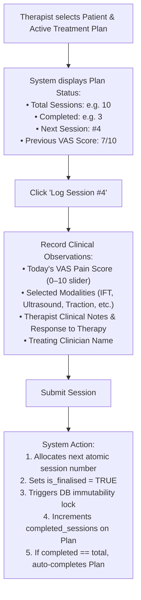
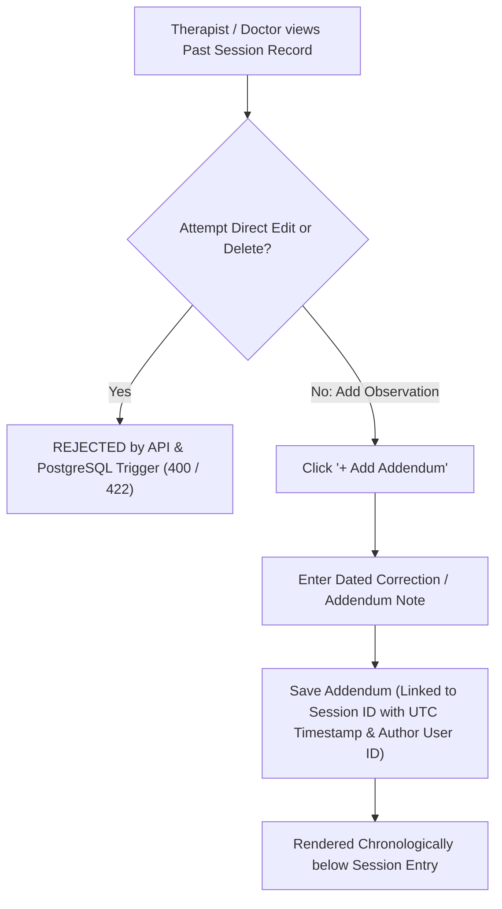

# Phase 14: Prescriptions, Treatment Plans & Sessions — Scope & Clinical Workflow

**Phase:** 14  
**Title:** Prescriptions, Treatment Plans & Physiotherapy Sessions  
**Status:** Planning Baseline  
**Branch:** `planning/phase-14-treatment-records`  
**Requirements Covered:** `RX-01`, `TRT-01`, `TRT-02`, `TRT-03`  

---

## 1. Scope Lock

### What Phase 14 Includes
1. **Prescription Management (`RX-01`):**
   - Doctor writes structured prescriptions with multi-item medicine lists (Medicine Name, Dosage, Frequency e.g. "1-0-1", Duration in days, Instructions e.g. "After food with warm water").
   - Captures diagnosis, general advice, dietary restrictions, and follow-up consultation date.
   - Prescriptions can link to an encounter (`encounter_id`) or patient.
   - Printable bilingual prescription slip with hospital letterhead, patient details, and English clinical items alongside static Hindi labels using the bundled Devanagari font.
2. **Treatment Plans & Packages (`TRT-01`):**
   - Creation of therapy packages (e.g. "10-Session Lumbar Spine Rehabilitation", "15-Session Frozen Shoulder Mobilisation").
   - Captures target condition/complaint, referral source (`referred_by`), agreed session count, and agreed package fee (in integer paise).
   - Package status lifecycle: `ACTIVE` $\rightarrow$ `COMPLETED` or `CANCELLED`.
   - Auto-computation of progress (`completed_sessions` / `total_sessions`).
3. **Physiotherapy Session Logs & VAS Pain Scoring (`TRT-02`):**
   - Chronological logging of individual therapy sessions under an active plan.
   - Concurrency-safe sequential session numbering (Session 1, 2, 3...) per plan.
   - VAS (Visual Analogue Scale) pain score on a mandatory $0 \text{ to } 10$ scale ($0 = \text{No Pain}$, $10 = \text{Worst Unbearable Pain}$).
   - Multi-select modalities applied (e.g., IFT, TENS, Ultrasound, Lumbar/Cervical Traction, Hot/Cold Pack, Therapeutic Exercise, Manual Therapy).
   - Treating therapist/clinician identification and narrative progress observations.
4. **Session Immutability & Addenda (`TRT-03`):**
   - Submitted session records are immediately marked finalized (`is_finalised = TRUE`).
   - Database trigger and API validation reject any `UPDATE` or `DELETE` on finalized sessions.
   - Modifications or retrospective observations are recorded strictly as dated addenda referencing the session ID.
5. **Patient Registration Form Gap Reconciliation (`OQ-13`):**
   - Clean architectural mapping of the client's physical paper registration slip without compromising database normalization or concurrency safety.

### What Phase 14 Excludes
1. **Payments & Ledger Transactions:** Recording cash/UPI/card fee receipts, installment collections, discount tracking, and outstanding balance calculations are strictly deferred to **Phase 15: Billing, Receipts & Reversals** (`BIL-01`..`BIL-05`).
2. **Unified Patient Timeline (`CLN-03`):** Combining appointments, encounters, sessions, and payments into a single unified chronological feed is owned by **Phase 15** (where billing data exists to complete the timeline).
3. **Audit Log Viewer UI & Backups:** The administrative audit log search screen (`AUD-02`) and backup/restore subsystem (`BAK-01`..`BAK-03`) belong to **Phase 16**.
4. **Physical Printer Acceptance:** Laser/thermal printer verification against physical hospital hardware belongs to **Phase 17**.

---

## 2. Reconciliation of Client Registration Form Gap (`OQ-13`)

The client's physical registration slip contains fields spanning three different clinical and operational stages:

| Client Form Field | Logical Domain | Architectural Destination | Phase |
|---|---|---|---|
| **Identity & Address** (Name, Guardian, Age, Sex, Address, Mobile, District, State) | Demographics | `patients` table (canonical identity) | **Phase 12 (Complete)** |
| **Allergies & Medical Alerts** | Clinical Demographics | `patients.allergies` | **Phase 12 (Complete)** |
| **In / Out Date & Time** | Visit Operations | `appointments.check_in_at` / `check_out_at` & `clinical_encounters.created_at` | **Phase 13 (Complete)** |
| **Condition / Chief Complaint** | Clinical Assessment | `clinical_encounters.symptoms` & `treatment_plans.condition_diagnosis` | **Phases 13 & 14** |
| **Reference / Referred By** | Referral Source | `treatment_plans.referred_by` & `patients.notes` | **Phase 14** |
| **Number of Sessions** | Physiotherapy Package | `treatment_plans.total_sessions` | **Phase 14** |
| **Total Amount Agreed** | Package Contract | `treatment_plans.agreed_price_paise` | **Phase 14** |
| **Amount Paid & Balance Due** | Financial Ledger | `payments` & `bills` (derived balance, never static) | **Phase 15** |

### Form Mapping Principles
1. **Never store editable balances in the patient table:** Financial balances must be derived dynamically from ledger payments minus billed packages/fees (`BIL-03`). A mutable column in `patients` invites race conditions, double counting, and audit drift.
2. **Separate repeatable treatment plans from static patient identity:** A returning patient with a recurrence 6 months later needs a *new* treatment package with a fresh session count, not an overwrite of their original demographic record.
3. **Composite Print Slip Integration:** The printable Registration Card and Prescription Slip will join `patients` + active `treatment_plans` + active `clinical_encounters` + `ledger` to print the exact layout expected by the clinic desk.

---

## 3. Clinical Workflow Specifications

### Workflow A: Prescription Issuance

### Workflow B: Treatment Plan / Package Creation

### Workflow C: Physiotherapy Session Logging with VAS Pain Score

### Workflow D: Immutable Session Corrections via Addenda

