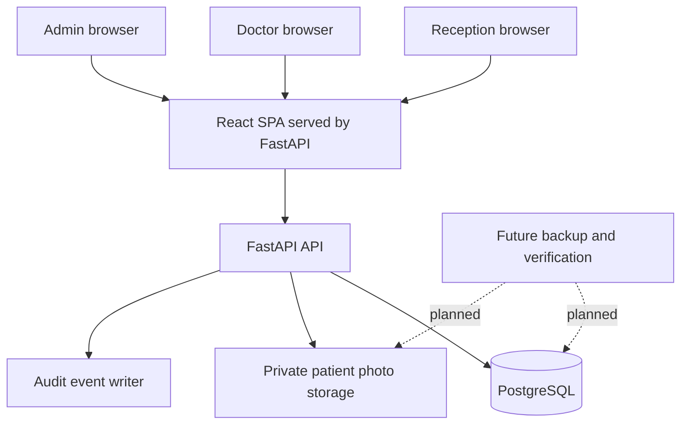

# Architecture — Kalyan Hospital v3.0

**Status:** Implemented baseline through Phase 13; Phases 14–17 remain planned/incomplete. See `.planning/STATE.md` for recorded gate status and `SECURITY.md` for known permission findings.

## 1. System context

One central on-premises server provides a single browser application and API to 3–5 clinic PCs over the hospital LAN. Runtime operation is designed not to depend on internet access.

## 2. Implemented technology and repository layout

- Frontend: React 19 + TypeScript + Vite, one SPA with role-specific areas.
- Backend: Python FastAPI; business rules and authorization are enforced server-side.
- Database: PostgreSQL 18, SQLAlchemy 2 and Alembic migrations.
- Authentication: Argon2id password hashing, HttpOnly session cookies and CSRF protections.
- Files: patient photos stored server-side and streamed through authenticated API endpoints.
- Deployment target: central server and browser clients on isolated clinic LAN; final operational acceptance is Phase 17.

Key source locations:
- `backend/src/kalyan_api/core/permissions.py`: roles and permission catalogue.
- `backend/src/kalyan_api/core/policy.py`: permission dependency/policy enforcement.
- `backend/src/kalyan_api/routers/patients.py`: registration, search, demographic updates and photo endpoints.
- `backend/src/kalyan_api/services/urn_service.py`: transactional URN allocator.
- `backend/src/kalyan_api/routers/appointments.py`: appointments, token queue and status transitions.
- `backend/src/kalyan_api/routers/encounters.py`: clinical encounters, finalization and addenda.
- `frontend/`: React SPA.
- `backend/alembic/`: database migrations.

The legacy `app/` PySide6/SQLite tree is retained for reference and migration analysis; it is not the v3 runtime.

## 3. Authentication and first-run bootstrap

Implemented Phase 11 behavior includes individual accounts, Argon2id password hashing, HttpOnly session cookies, CSRF protections, idle/session controls, account lockout, first-login password change, user administration and one-time first-admin setup.

The bootstrap contract is:
1. Setup is available only while no administrator exists.
2. A high-entropy one-time code is generated by the server and shown through the local server console.
3. Browser setup submits the code with the first-admin details.
4. Creation and code consumption are guarded against concurrent submissions.
5. After successful setup, public bootstrap remains disabled, including after restart.
6. Recovery is via local administrative CLI, not a hidden HTTP backdoor.

Do not place setup codes, passwords or session secrets in logs, docs, screenshots or commits.

## 4. Authorization and roles

The fixed roles are Admin, Reception and Doctor. Protected API routes use backend permission dependencies; frontend route guards are not the security boundary. Doctor-specific appointment and encounter endpoints apply doctor-scope checks. Reception is denied clinical encounter authoring/reading.

The current catalogue is in `permissions.py`; it is the source of truth for implemented grants. Known mismatch: only Reception currently receives `PHOTO_READ`, although the patient photo endpoint requires it. Admin and Doctor therefore do not have this permission through the current role map. This requires a deliberate policy decision and tests before acceptance.

Do not infer that every product-level role requirement is fulfilled merely because a permission exists in the enum; check the assigned role set and object-level scope.

## 5. Implemented data domains through Phase 13

- Identity, users, sessions, role permissions and bootstrap state.
- Clinic settings, doctors and consultation fee catalogue.
- Patients, photo metadata and annual URN sequence.
- Appointments, per-doctor daily token sequences and status.
- Clinical encounters and dated addenda.

Future planned domains:
- Prescriptions and prescription items.
- Treatment plans/packages and physiotherapy sessions.
- Payments, reversals and receipts.
- Audit viewer, backup runs/manifests and integrity reports.

## 6. Concurrency and transactions

- Patient URNs are allocated using a PostgreSQL upsert on the annual sequence row, returning the incremented value within the registration transaction.
- Appointment token allocation uses row-level locking; see the appointment/token service and Phase 13 tests.
- Patient and appointment edits use version checks and return conflict responses for stale versions.
- Audit writes are performed alongside sensitive patient and appointment/encounter mutations in the same database session/transaction.

URN implementation is transactional and race-safe in the current service. The business rule for voided registrations and any promise of gap-free numbers still needs explicit acceptance semantics; a rollback should roll back the sequence increment with the transaction.

## 7. Clinical integrity

Implemented Phase 13 encounter flow supports draft notes, finalization and dated addenda. Finalized encounter edits are rejected by the API; database-level protection is also recorded in the Phase 13 migration/gate notes. Doctor scope is enforced on encounter reads and writes. Phase 14 must extend the same immutable-history approach to prescriptions, treatment plans and session logs.

## 8. Audit

An audit-event writer and append-only audit foundation were implemented in Phase 11 and are used by subsequent modules. The Admin audit viewer, filtering UI, full domain coverage and operational audit review belong to Phase 16 and are not yet complete.

## 9. Patient file security

Patient photos are stored outside the public frontend assets and served through an authenticated endpoint requiring `PHOTO_READ`. Upload requires `PHOTO_WRITE`. The role map currently grants both photo permissions to Reception only. Admin/Doctor access must not be assumed; track and resolve the role matrix discrepancy before production acceptance.

## 10. Billing, backup and restore — planned

Phase 15 must implement an append-only integer-paise ledger, transactional overpayment prevention, receipt sequence/reprint semantics and Admin reversals. Phase 16 must implement PostgreSQL + patient-file backup bundles, checksum manifests, scheduled/manual backup, staged restore and integrity reports. These are not complete merely because future permission enum values exist.

## 11. Offline deployment and acceptance — planned

The target serves bundled frontend assets locally and must not require a CDN, cloud auth, telemetry or internet API at runtime. Phase 17 owns central-server installation, firewall/LAN configuration, auto-start and power recovery, actual printer sign-off, 3–5 client-PC offline testing and clean-machine restore acceptance.

## 12. Testing and evidence

The Phase 13 state record reports 422 backend tests, 92.51% backend coverage and 58 frontend tests passing at its gate. Treat those as recorded results for that milestone, not as a fresh run for this documentation commit. Re-run CI and retain logs tied to the exact release SHA.

---
*Architecture synchronized to the repository's v3 source and recorded Phase 13 state on 2026-11-01.*
