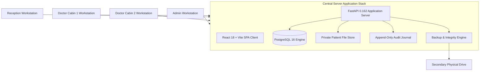

# Architecture — Kalyan Hospital v3.0

**Status:** Implemented and Operational v3.0 Architecture. Phases 11–21 complete, Phase 22 (Integrated OPD Workflow) deployed through Wave 2. See [PRD](PRD.md), [Security](SECURITY.md), [Decisions](DECISIONS.md), and [Consolidated UAT Report](docs/engineering/KALYAN_OPD_UAT_CONSOLIDATED_REPORT.md).

## 1. System context

One central on-premises server serves 3–5 browser clients across the Kalyan Hospital LAN. Runtime operation is strictly offline-first and does not depend on internet access.



## 2. Technology Stack and Repository Layout

The production implementation uses:
- **Frontend:** React 18, TypeScript 5, Vite, TailwindCSS, Lucide-React, TanStack Query.
- **Backend:** Python 3.12, FastAPI 0.162, SQLAlchemy 2.0.55 ORM, Alembic migrations.
- **Database:** PostgreSQL 16 with row-level locks, foreign-key cascades, and unique constraints.
- **File Storage:** Private server-side directory with access-controlled streaming endpoints.
- **Deployment:** Single on-premises server hosting FastAPI API and serving static SPA bundle to LAN clients.

### Implemented Codebase Layout

```text
frontend/
├── src/
│   ├── admin/             # Admin module registries & SSOT navigation
│   ├── api/               # API clients, queries, mutations, type definitions
│   ├── auth/              # AuthContext, role guards, token/session management
│   ├── components/        # Shared UI (AppShell, modals, badges, print templates, alerts)
│   │   └── checkin/       # OPD check-in panels, priority badges, appointment lists
│   ├── pages/             # Route-level screens (Check-in, Queues, Encounters, Billing, Admin)
│   └── router.tsx         # Central application routing with RBAC guards
backend/
├── src/kalyan_api/
│   ├── core/              # Config, database engine, security hashing, audit writers
│   ├── migrations/        # Alembic migration scripts (0001 through 0027)
│   ├── models.py          # SQLAlchemy relational models
│   ├── routers/           # FastAPI thin routers (auth, patients, appointments, billing, encounters, etc.)
│   ├── schemas/           # Pydantic v2 validation contracts
│   └── services/          # Domain services (patient, visit, booking, billing, audit, backup, token)
tests/ & backend/tests/    # 1,392 unit, integration, RBAC matrix, concurrency, and gate tests
docs/                      # Engineering status, inventories, audit reports, and UAT results
```

Routes remain thin; domain services manage invariants, transactions, and audit boundaries. The React frontend enforces role-based UX, but all security and financial invariants are strictly enforced server-side.

## 3. Integrated OPD Workflow Architecture (Phase 22)

The hospital's central clinical and administrative operation runs as an end-to-end OPD lifecycle:

```
[Arrival / Booking] 
       │
       ▼
[Check-in & Token Desk] ──► Auto-register new patient (permanent URN) or find existing
       │                ──► Open or join Visit (Referred By mandatory, default: Self)
       │                ──► Assign Doctor & generate monotonic queue token
       │                ──► Set Triage Classification (Normal, Priority, Emergency)
       │                ──► Snapshot Doctor Consultation Fee into bill_items
       ▼
[Waiting Room & Queue]  ──► Live computed priority order (Emergency → Priority → Normal)
       │                ──► Instant Emergency Alert Banner on Doctor's screen
       │                ──► Doctor emergency acknowledgment timestamp recorded
       │                ──► Doctor can reassign patient to another doctor in same visit
       ▼
[Doctor Cabin]          ──► Doctor calls patient (In Cabin state)
       │                ──► Universal consultation workspace (auto-save drafts, vitals, templates)
       │                ──► Prescriptions Rx pad & treatment package recommendations
       │                ──► Doctor may adjust/waive consultation fee with mandatory reason
       │                ──► Clinical completion locks encounter
       ▼
[Billing & Checkout]    ──► Aggregates Consultation fee snapshot + Medicines + Procedures
       │                ──► Displays previous dues separately (never merged into current bill)
       │                ──► Cash / UPI payment recording in integer-paise ledger
       │                ──► Transactional receipt issuance with printable layout
       ▼
[Patient Out]           ──► Visit checkout complete; closure with balance allowed with reason
```

## 4. Authentication, Sessions & First-Run Bootstrap

- **Password Security:** Individual accounts only, hashed using Argon2id with unique salts.
- **Session Control:** Secure HTTP-only cookies, idle timeout revocation, and single-active-session policy per user.
- **Console-Only Bootstrap:** When the database contains no administrator, a cryptographically random, short-lived setup code is printed only to the local server console. The setup wizard consumes this code atomically in a single transaction to create the initial admin. Public bootstrap endpoints are permanently disabled thereafter. Break-glass recovery is local CLI only.

## 5. Authorization and Role Hierarchy

Enforced server-side across all endpoints via route policy markers:
- **`ADMIN`:** Full configuration, user management, audit review, asset/print template control, database backup/restore, and financial reversals (reversals require reason; admin cannot post routine payments).
- **`RECEPTION`:** Patient registration, check-in, token generation, appointment management, billing, payment collection, receipt printing, and visit checkout. Cannot finalize clinical notes or administer doctor-only settings.
- **`DOCTOR`:** Queue inspection, clinical encounters, vitals recording, prescription authoring, treatment plan creation, session logging, consultation fee adjustments, and emergency acknowledgment. Cannot collect payments or delete patient records.

## 6. Concurrency, Locking and Invariants

1. **Patient URN Allocation:** Transactional allocation with gapless advisory locks and duplicate prevention by phone, name, and demographic checks.
2. **Monotonic Daily Tokens:** Strictly ascending token integers scoped per `(doctor_id, appointment_date)`. Tokens are never recycled or reissued upon cancellation.
3. **Optimistic Locking:** Entity mutations carry version numbers (`version` column). Conflicting simultaneous edits return HTTP 409 (`version_conflict`) with server reloads, never overwriting silently.
4. **Financial Ledger & Integer Paise:** All monetary values are stored as 64-bit integer paise (INR ₹1.00 = 100 paise). Balances are computed dynamically from posted payments and bill line items. Simultaneous payments lock the target ledger scope to prevent negative balances or overpayments.
5. **Fee Snapshotting:** When a patient is checked in, the assigned doctor's current consultation fee is copied into `bill_items` as a snapshot. Subsequent rate modifications never retroactively alter existing bills.

## 7. Clinical and Financial Immutability

- **Finalized Medical Encounters:** Immutable upon doctor finalization. Amendments require dated addenda with clinician ID, timestamp, and justification.
- **Ledger Entries & Receipts:** Posted payments are immutable. Adjustments require compensating reversal transactions with mandatory administrative reasons and audit logging. Receipt reprints retain the original receipt sequence number and carry a visible `DUPLICATE` watermark.

## 8. Audit Journaling

Append-only audit events capture actor, timestamp, action, target entity, request ID, IP/workstation, outcome, and structured before/after payloads for all sensitive demographic, clinical, financial, and administrative operations. The audit table is queryable only by `ADMIN`.

## 9. File Security & Asset Storage

Patient photographs and clinic branding assets are stored in a private directory outside the public web root. File access requires session authentication and role verification. File paths are verified to prevent path traversal; uploads are validated by MIME type, byte header, and maximum size limits.

## 10. Backup, Restore & Disaster Recovery

- **Automated Snapshots:** PostgreSQL dump combined with referenced file store into timestamped, checksummed `.tar.gz` archives.
- **Verification & Staging Restore:** Restores run into an isolated staging database and directory to verify checksums and schema integrity before production cutover.
- **Physical Isolation:** Backups are written to a secondary physical drive to protect against single-disk failures.

## 11. Testing and Acceptance Evidence

System reliability is evidenced by:
- **Backend Pytest:** 1,392 tests (1,391 passed, 1 skipped) verifying models, services, RBAC matrix (724 route-role combinations), concurrency, and data invariants.
- **Frontend Vitest:** 427 tests across 65 suites (422 passed, 5 skipped) verifying rendering, state transitions, modals, forms, and accessibility.
- **Live Staging UAT:** 182-case end-to-end integration and concurrency test suite against live PostgreSQL (`kalyan_test`).

---
*Kalyan Hospital System Architecture — v3.0 Production Baseline*