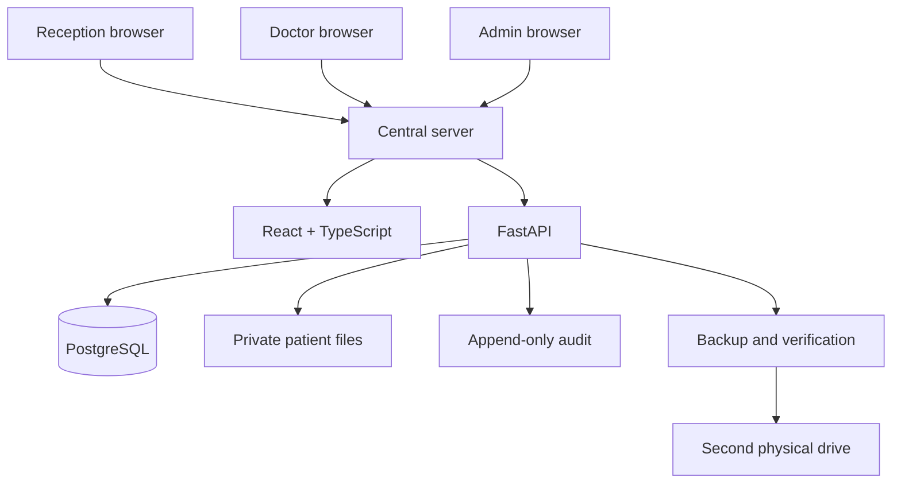

# Architecture — Kalyan Hospital v3.0

**Status:** Target architecture; not yet implemented. See PRD.md, SECURITY.md and DECISIONS.md.

## 1. System context

One central on-premises server serves 3–5 browser clients on the hospital LAN. Runtime operation must not depend on internet.



## 2. Target stack and repository layout

- Frontend: React + TypeScript, one application with role-specific routes.
- Backend: Python + FastAPI; business rules and authorization live here.
- Database: PostgreSQL; SQLAlchemy models and Alembic migrations.
- Files: private server-side directory with generated names and authorization-checked download routes.
- Deployment: central server, browser clients, offline runtime.

Suggested layout:

```text
frontend/src/{app,features,shared}
backend/app/{api/v1,core,models,schemas,services,repositories,audit,files,backup,migrations}
tests/{unit,integration,security,concurrency,acceptance}
docs/
```

Routes should be thin. Services own invariants and transaction boundaries. React must not be trusted to enforce permissions.

## 3. Authentication and first-run bootstrap

Individual accounts only. Passwords use Argon2id or another approved modern password hash. Use secure session handling, CSRF protection for cookie-authenticated mutations, idle expiry, lockout/backoff and session revocation.

First-run sequence:
1. Backend detects that no administrator exists.
2. Server generates a cryptographically random, short-lived one-time setup code and prints it only to the local server console.
3. Browser setup is enabled only in this state; secret is never exposed through a public API.
4. First administrator submits code, username and password.
5. A database transaction locks bootstrap state, validates and consumes code, creates administrator, writes audit event and marks setup complete.
6. Simultaneous submissions: exactly one succeeds.
7. All public setup endpoints are permanently disabled after commit.
8. Recovery is a documented local CLI procedure, never a hidden HTTP backdoor.

No default production credentials or seeded production accounts.

## 4. Authorization and roles

Fixed Admin, Reception and Doctor permission catalogue. Every protected endpoint and object/file access checks authorization server-side. Automated route coverage must fail if a protected route lacks a declared policy. Account deactivation revokes sessions and preserves historical attribution.

Recommended doctor policy: read clinically relevant records across doctors, write only assigned cases. This is pending client approval. Final role-to-permission matrix is in SECURITY.md.

## 5. Data model

Conceptual entities:
- users, sessions, bootstrap_state, fixed permissions
- clinic_settings, branches, doctors, fee_catalogue
- patients, patient_files, patient_id_counters
- appointments
- clinical_encounters, clinical_addenda, prescriptions, prescription_items
- treatment_plans, treatment_sessions, treatment_addenda
- charge/accounts, payments, payment_reversals, receipt_counters
- audit_events, backup_runs, backup_verification_reports

Use foreign keys, unique indexes, check constraints and created_by/created_at/version fields. Balances are derived, not stored editable.

## 6. Concurrency and transactions

- Patient URN allocation and receipt numbering are transactional and unique. Define what gap-free means when a transaction rolls back or a record is voided.
- Payment posting locks the relevant account/ledger scope, recalculates balance inside transaction, rejects negative and overpayment, and commits ledger + receipt atomically.
- Stale edits use version/ETag/If-Match and return HTTP 409; never silently overwrite.
- Audit event commits in the same transaction as sensitive mutation. Audit failure aborts the mutation.
- Use PostgreSQL constraints as the final integrity boundary, not only application validation.

## 7. Clinical and financial immutability

Finalized encounters, prescriptions and sessions are immutable. Corrections are dated addenda with author, reason and original-record link. Posted payments are append-only; reversal is a new compensating event requiring Admin authorization and reason. Reprints retain original receipt number and are marked DUPLICATE.

## 8. Audit

Append-only audit events include actor, timestamp, action, entity, request ID, outcome, reason and structured before/after values where relevant. Avoid logging passwords, setup codes, tokens or unnecessary clinical narrative. Restrict audit access to Admin. Protect rows from ordinary update/delete.

## 9. File security

Files stay outside public web root. Validate content type and size, generate opaque names, prevent path traversal, store checksums and enforce patient-level authorization on every read. Backup must include every referenced file.

## 10. Backup and restore

Consistent PostgreSQL backup plus all referenced files. Manifest includes app/schema version, timestamps and database/file checksums. Support manual and scheduled backup to second drive. Restore into isolated staging DB and file directory; verify checksums, schema compatibility and integrity report before controlled cutover. Create pre-restore safety snapshot and document rollback. Clean-machine restore is mandatory.

## 11. Offline deployment and security

Serve all frontend assets locally. No runtime CDN, cloud auth, telemetry or internet API. Restrict firewall to clinic subnet and required ports; no public exposure or router port forwarding. Stable LAN address and UPS are recommended. HTTPS preferred; HTTP first-release exception requires explicit approval and must be described as unencrypted. Auto-start services after power recovery.

## 12. Testing

Required: unit tests; API/role matrix for every route; unguarded-route failure test; concurrency tests for URN, receipt, payment and stale edits; clinical immutability/addenda; audit atomicity; file authorization/path traversal; corrupted backup rejection; clean-machine restore; offline deployment; actual clinic printer acceptance.

## 13. Legacy boundary

The current PySide6/SQLite app is legacy reference, not v3 runtime. Do not share its database file over a network. Reuse only reviewed business rules, assets and tests.

---
*Architecture describes intended v3.0 system, not implementation status.*