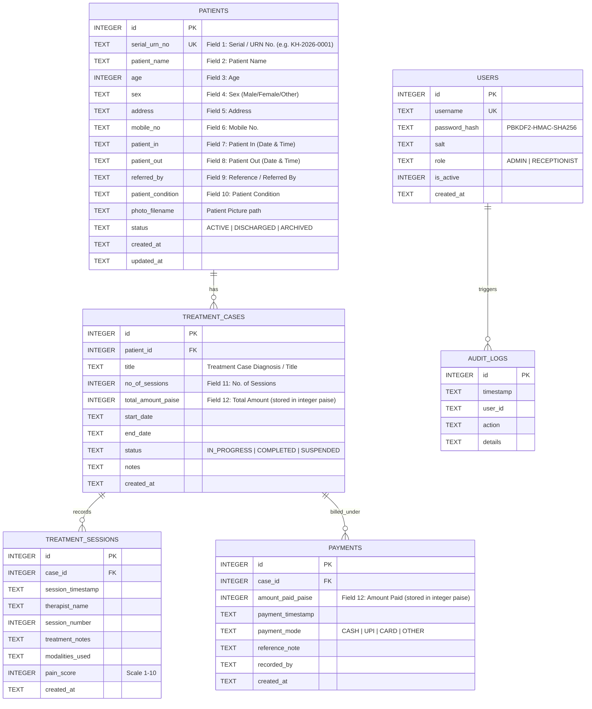

# Architecture & Technical Design Document
## Kalyan Hospital — Offline Patient & Physiotherapy Management System

**Version:** 1.0  
**Stack:** Python 3 + PySide6 (Qt 6) + SQLite 3  
**Architecture Pattern:** Layered Service-Repository Architecture  

---

## 1. Architectural Principles & Overview

The system is designed as a standalone, zero-network desktop application. To ensure code maintainability, testability, and resilience during AI-assisted development, a strict separation of concerns is enforced:

```
┌─────────────────────────────────────────────────────────────┐
│                    PySide6 Presentation Layer               │
│   (Main Window, Sidebar Navigation, Views, Dialogs, Print)  │
└──────────────────────────────┬──────────────────────────────┘
                               │ Calls methods (no raw SQL)
                               ▼
┌─────────────────────────────────────────────────────────────┐
│                      Application Service Layer              │
│   (PatientService, TreatmentService, BillingService, etc.)   │
│   • Business rules, currency arithmetic, validation, backup  │
└──────────────────────────────┬──────────────────────────────┘
                               │ Invokes entity persistence
                               ▼
┌─────────────────────────────────────────────────────────────┐
│                      Data Repository Layer                  │
│   (PatientRepository, TreatmentRepository, PaymentRepo)     │
│   • Parameterized SQL queries, entity mapping, transactions │
└──────────────────────────────┬──────────────────────────────┘
                               │ Executes via
                               ▼
┌─────────────────────────────────────────────────────────────┐
│                  SQLite Database Connection                 │
│   (sqlite3 with WAL mode, foreign keys ON, local data dir)  │
└─────────────────────────────────────────────────────────────┘
```

### Golden Rules:
1. **No SQL in UI:** PySide6 widgets and view classes never execute SQLite queries directly. They only invoke Services.
2. **Deterministic Financial Math:** All currency figures are handled in integer `paise` (1 INR = 100 paise) to eliminate IEEE 754 floating-point rounding errors.
3. **Database-Enforced Integrity:** `PRAGMA foreign_keys = ON;` is executed on every database connection.
4. **Isolated File I/O:** Database files and patient photos are stored in a dedicated local writable application directory, completely separated from application source code.

---

## 2. Directory & Component Structure

```text
kalyan-hospital/
├── PRD.md
├── ARCHITECTURE.md
├── TASKS.md
├── TEST_PLAN.md
├── SECURITY.md
├── DECISIONS.md
├── main.py                     # Application bootstrap & QApplication lifecycle
├── app/
│   ├── __init__.py
│   ├── config.py               # Path definitions, app constants, versioning
│   ├── ui/
│   │   ├── __init__.py
│   │   ├── main_window.py      # Top QMainWindow, layout container
│   │   ├── sidebar.py          # Left navigation sidebar
│   │   ├── styles.py           # Clean hospital theme QSS stylesheet
│   │   ├── views/
│   │   │   ├── dashboard_view.py
│   │   │   ├── patient_list_view.py
│   │   │   ├── patient_form_view.py
│   │   │   ├── treatment_view.py
│   │   │   ├── payment_view.py
│   │   │   └── backup_view.py
│   │   └── dialogs/
│   │       ├── session_dialog.py
│   │       ├── payment_dialog.py
│   │       └── auth_dialog.py
│   ├── db/
│   │   ├── __init__.py
│   │   ├── connection.py       # Connection factory, WAL mode, pragmas
│   │   └── schema.sql          # Canonical DDL statements
│   ├── repositories/
│   │   ├── __init__.py
│   │   ├── base_repository.py
│   │   ├── patient_repository.py
│   │   ├── treatment_repository.py
│   │   ├── payment_repository.py
│   │   └── user_repository.py
│   ├── services/
│   │   ├── __init__.py
│   │   ├── patient_service.py  # ID generation, validation, search
│   │   ├── treatment_service.py # Cases & session tracking
│   │   ├── billing_service.py  # Fee calculations, payments, balance
│   │   ├── backup_service.py   # SQLite hot backup & restore verification
│   │   └── auth_service.py     # Password verification, session state
│   └── printing/
│       ├── __init__.py
│       ├── document_builder.py # HTML/QTextDocument builder for A4
│       └── print_manager.py    # QPrinter & QPrintPreviewDialog integration
├── tests/
│   ├── conftest.py             # In-memory / temporary DB fixtures
│   ├── test_schema.py
│   ├── test_patient_service.py
│   ├── test_billing_service.py
│   ├── test_backup_restore.py
│   └── test_auth.py
└── data/                       # Local data folder (excluded from Git)
    ├── kalyan.db
    ├── photos/
    └── backups/
```

---

## 3. Database Design & Relational Schema (SQLite)

### 3.1 Entity Relationship Diagram (ERD)



### 3.2 Canonical DDL (`app/db/schema.sql`)

```sql
PRAGMA foreign_keys = ON;

-- Patients Master Table (Fields 1-10 + Picture)
CREATE TABLE IF NOT EXISTS patients (
    id INTEGER PRIMARY KEY AUTOINCREMENT,
    serial_urn_no TEXT NOT NULL UNIQUE,          -- 1. Serial / URN No.
    patient_name TEXT NOT NULL,                  -- 2. Patient Name
    age INTEGER NOT NULL CHECK (age >= 0 AND age <= 125), -- 3. Age
    sex TEXT NOT NULL CHECK (sex IN ('Male', 'Female', 'Other')), -- 4. Sex
    address TEXT NOT NULL,                       -- 5. Address
    mobile_no TEXT NOT NULL,                     -- 6. Mobile No.
    patient_in TEXT NOT NULL DEFAULT (datetime('now', 'localtime')), -- 7. Patient In (Date & Time)
    patient_out TEXT,                            -- 8. Patient Out (Date & Time)
    referred_by TEXT DEFAULT '',                 -- 9. Reference / Referred By
    patient_condition TEXT NOT NULL,             -- 10. Patient Condition
    photo_filename TEXT DEFAULT '',              -- Patient Picture filename in data/photos/
    status TEXT NOT NULL DEFAULT 'ACTIVE' CHECK (status IN ('ACTIVE', 'DISCHARGED', 'ARCHIVED')),
    created_at TEXT NOT NULL DEFAULT (datetime('now', 'localtime')),
    updated_at TEXT NOT NULL DEFAULT (datetime('now', 'localtime'))
);

CREATE INDEX IF NOT EXISTS idx_patients_serial_urn ON patients(serial_urn_no);
CREATE INDEX IF NOT EXISTS idx_patients_mobile ON patients(mobile_no);
CREATE INDEX IF NOT EXISTS idx_patients_name ON patients(patient_name);

-- Treatment Cases Table (Field 11 & Field 12 Total Amount)
CREATE TABLE IF NOT EXISTS treatment_cases (
    id INTEGER PRIMARY KEY AUTOINCREMENT,
    patient_id INTEGER NOT NULL,
    title TEXT NOT NULL,
    no_of_sessions INTEGER NOT NULL DEFAULT 1 CHECK (no_of_sessions >= 1), -- 11. No. of Sessions
    total_amount_paise INTEGER NOT NULL DEFAULT 0 CHECK (total_amount_paise >= 0), -- 12. Total Amount (Paise)
    start_date TEXT NOT NULL DEFAULT (date('now', 'localtime')),
    end_date TEXT,
    status TEXT NOT NULL DEFAULT 'IN_PROGRESS' CHECK (status IN ('IN_PROGRESS', 'COMPLETED', 'SUSPENDED')),
    notes TEXT DEFAULT '',
    created_at TEXT NOT NULL DEFAULT (datetime('now', 'localtime')),
    FOREIGN KEY (patient_id) REFERENCES patients(id) ON DELETE RESTRICT
);

CREATE INDEX IF NOT EXISTS idx_treatment_cases_patient ON treatment_cases(patient_id);

-- Treatment Sessions Table (Clinical Progress Tracking)
CREATE TABLE IF NOT EXISTS treatment_sessions (
    id INTEGER PRIMARY KEY AUTOINCREMENT,
    case_id INTEGER NOT NULL,
    session_timestamp TEXT NOT NULL DEFAULT (datetime('now', 'localtime')),
    therapist_name TEXT NOT NULL DEFAULT 'Physiotherapist',
    session_number INTEGER NOT NULL,
    treatment_notes TEXT NOT NULL,
    modalities_used TEXT DEFAULT '',
    pain_score INTEGER CHECK (pain_score IS NULL OR (pain_score >= 0 AND pain_score <= 10)),
    created_at TEXT NOT NULL DEFAULT (datetime('now', 'localtime')),
    FOREIGN KEY (case_id) REFERENCES treatment_cases(id) ON DELETE RESTRICT
);

CREATE INDEX IF NOT EXISTS idx_treatment_sessions_case ON treatment_sessions(case_id);

-- Payments Ledger Table (Field 12 Amount Paid & Balance Tracking)
CREATE TABLE IF NOT EXISTS payments (
    id INTEGER PRIMARY KEY AUTOINCREMENT,
    case_id INTEGER NOT NULL,
    amount_paid_paise INTEGER NOT NULL CHECK (amount_paid_paise > 0), -- 12. Amount Paid (Paise)
    payment_timestamp TEXT NOT NULL DEFAULT (datetime('now', 'localtime')),
    payment_mode TEXT NOT NULL DEFAULT 'CASH' CHECK (payment_mode IN ('CASH', 'UPI', 'CARD', 'OTHER')),
    reference_note TEXT DEFAULT '',
    recorded_by TEXT DEFAULT 'Staff',
    created_at TEXT NOT NULL DEFAULT (datetime('now', 'localtime')),
    FOREIGN KEY (case_id) REFERENCES treatment_cases(id) ON DELETE RESTRICT
);

CREATE INDEX IF NOT EXISTS idx_payments_case ON payments(case_id);

-- System Users Table
CREATE TABLE IF NOT EXISTS users (
    id INTEGER PRIMARY KEY AUTOINCREMENT,
    username TEXT NOT NULL UNIQUE,
    password_hash TEXT NOT NULL,
    salt TEXT NOT NULL,
    role TEXT NOT NULL DEFAULT 'RECEPTIONIST' CHECK (role IN ('ADMIN', 'RECEPTIONIST')),
    is_active INTEGER NOT NULL DEFAULT 1 CHECK (is_active IN (0, 1)),
    created_at TEXT NOT NULL DEFAULT (datetime('now', 'localtime'))
);

-- Sequence Tracker for Patient ID Generation
CREATE TABLE IF NOT EXISTS id_sequences (
    year INTEGER PRIMARY KEY,
    last_seq INTEGER NOT NULL DEFAULT 0
);
```

---

## 4. Key Subsystem Architectures

### 4.1 Currency & Billing Engine (`BillingService`)
- Standard float types (e.g. `199.99`) are prone to binary floating-point representation drift.
- All monetary inputs are converted to `int` paise upon entry:
  $$\text{paise} = \text{round}(\text{float}(\text{input}) \times 100)$$
- Display formatting reverses this:
  $$\text{formatted} = \text{f"₹\{paise / 100:,.2f\}"}$$
- **Balance Calculation:**
  $$\text{Balance (paise)} = \text{agreed\_fee\_paise} - \sum(\text{payments.amount\_paise})$$
- If $\sum(\text{payments}) > \text{agreed\_fee}$, `BillingService` raises a `ValidationException` unless administrative override is explicitly granted.

### 4.2 Local Hot Backup & Verified Restore Pipeline (`BackupService`)
1. **Creation:** SQLite provides a hot online backup API accessible in Python:
   ```python
   def create_backup(source_db_path, backup_dir):
       timestamp = datetime.now().strftime("%Y%m%d_%H%M%S")
       dest_file = os.path.join(backup_dir, f"kalyan_backup_{timestamp}.db")
       with sqlite3.connect(source_db_path) as src:
           with sqlite3.connect(dest_file) as dst:
               src.backup(dst)
       return dest_file
   ```
2. **Verification Before Replacement:**
   - Restore is never performed blindly onto the live database.
   - The candidate backup is opened into a temporary scratch file.
   - Run `PRAGMA integrity_check;`.
   - Verify table schemas and count essential records (`patients`, `treatment_cases`).
   - Only when verified: close connections, rename current live DB to `.db.bak`, and atomically promote restored file.

### 4.3 Standard A4 Print & PDF Generation (`document_builder.py`)
- Employs Qt's native `QTextDocument` styled with clean, print-optimized HTML/CSS.
- Target paper format: Standard ISO A4 ($210\text{ mm} \times 297\text{ mm}$) at 300 DPI.
- Previews render instantly via `QPrintPreviewDialog` with zoom and print controls.
- Exports directly to PDF via `QPrinter(QPrinter.PrinterMode.PdfFormat)`.
- **Top Header Block (faithful reproduction of Kalyan Hospital prescription pad):**
  - Deep maroon header band (`#6B1736`) with:
    - Hindi: **कल्याण हॉस्पीटल** (Large bold header)
    - Sub-header: **PHYSIOTHERAPY DEPARTMENT**
    - Right box: **Sl No. [Serial / URN No.]**
    - Clinic 1: नवादा थाना के सामने वाली गली, आरा, जिला- भोजपुर (बिहार) - 802301
    - Clinic 2: श्रीरामपुर रोड, गड़हनी, प्रखण्ड- उदवन्तनगर, जिला- भोजपुर (बिहार) - 802206
  - Clinician Credentials Grid:
    - **Left Column:** डॉ० मदन मोहन द्विवेदी / Dr. Madan Mohan Dwivedi, D.P.T (Pat.), O.C.T.M. (Delhi), O.C.S.P. (Gwaliar), M.B.S.A.P.O. (Bihar), Sr. Diploma Music (Allahabad), Senior Physiotherapist, Sports Physiotherapist, Ex Sadar Hospital, Arrah (Bhojpur), फिजियोरत्न से सम्मानित.
    - **Center Column:** Winged Caduceus emblem.
    - **Right Column:** डॉ० चंदन कुमार द्विवेदी / Dr. Chandan Kr. Dwivedi, B.P.T. (RGUHS) Bangalore, M.I.A.P., CDNT - Bangalore, CCT - Bangalore, Ex. INT. NIMHANS, Ex. INT. APOLLO, Ex. INT. RMH Bangalore, FMATS Varanasi, फिजियोथेरेपिस्ट.
  - Sub-banner: **श्री वशिष्ठ कल्याण ट्रस्ट द्वारा संचालित**
- **Document Title & 12 Form Fields:**
  - Header: **PATIENT REGISTRATION & TREATMENT RECORD**
  - Dedicated Patient Picture box.
  - 1. Serial / URN No.
  - 2. Patient Name
  - 3. Age & 4. Sex
  - 5. Address
  - 6. Mobile No.
  - 7. Patient In (Date & Time) & 8. Patient Out (Date & Time)
  - 9. Reference / Referred By
  - 10. Patient Condition
  - 11. No. of Sessions
  - 12. Payment Details: Total Amount (₹), Amount Paid (₹), Balance Amount (₹)
- **Dual Bottom Signatures & Date:**
  - `Patient / Attendant Signature: ______________________`
  - `Authorized Signature: ______________________`
  - `Date: ______________________`

---

## 5. UI Layout & Style System

- **Layout Container:** `QMainWindow` featuring a fixed left navigation sidebar (240px width) and a central `QStackedWidget` for view switching.
- **Palette & Typography:**
  - Application canvas: Neutral clinic surface (`#F5F7F5`) and white cards (`#FFFFFF`).
  - Application identity: Trust green (`#155B43`), clinical blue (`#234B86`), and restrained gold (`#C39A35`); teal (`#0D9488`) remains the focus/interaction accent.
  - Text: High-contrast slate (`#202B33`) with `Segoe UI` and `Nirmala UI` fallbacks for Hindi.
  - Borders & Cards: Soft neutral borders (`#DDE5DF`) and 8–10px card corners.
  - Print identity: The A4 prescription retains the physical pad's maroon header (`#6B1736`); print branding is intentionally separate from the app-shell palette.
- **No external fonts/CDNs:** 100% locally bundled Qt styling.

---
*Architecture document approved for implementation planning.*

