# Hospital OPD & Clinical Management System

<div align="center">

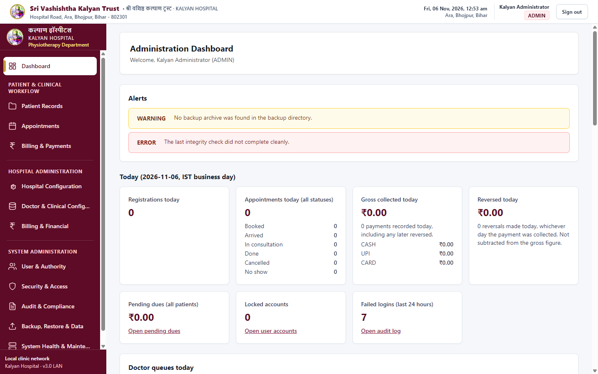

### Enterprise-Grade, Offline-First Outpatient Department (OPD) & Clinical Practice Management Platform

[](https://python.org)
[](https://fastapi.tiangolo.com)
[](https://react.dev)
[](https://www.typescriptlang.org)
[](https://www.postgresql.org)
[](https://vitejs.dev)
[](#architecture)
[](#license)

[Key Features](#key-features) • [System Architecture](#system-architecture) • [Role Workspaces](#role-workspaces) • [Business Invariants](#hospital-business-invariants) • [Quickstart](#quickstart) • [Security & Compliance](#security--compliance)

</div>

---

## Overview

The **Hospital OPD Management System** is a centralized, offline-first local area network (LAN) platform engineered for hospitals, outpatient polyclinics, and rehabilitation facilities. 

Designed specifically for environments with intermittent or zero internet connectivity, the system deploys on a single central hospital workstation and coordinates real-time clinical, financial, and intake workflows across 3–15 connected terminals (Reception, Doctor Cabins, Nursing Desks, Billing Counters, and Administrative Offices) via modern web browsers.

```
                              ┌─────────────────────────────────────────┐
                              │     Hospital Central Server (Host)      │
                              │  FastAPI Core · PostgreSQL 16 · Assets  │
                              └────────────────────┬────────────────────┘
                                                   │ Local Air-Gapped LAN
         ┌──────────────────────────┬──────────────┴────────────┬──────────────────────────┐
         ▼                          ▼                           ▼                          ▼
┌──────────────────┐      ┌──────────────────┐        ┌──────────────────┐       ┌──────────────────┐
│  Reception Desk  │      │  Doctor Cabin 1  │        │  Doctor Cabin 2  │       │  Admin / Billing │
│ Check-In & Token │      │ OPD Consultation │        │ Physiotherapy Rx │       │ Reports & Audit  │
└──────────────────┘      └──────────────────┘        └──────────────────┘       └──────────────────┘
```

---

## Visual Tour & Interface Previews

### 1. Reception & Patient Intake
Fast walk-in intake, search with phonetic matching, live token generation, and multi-tier queue routing.

| Reception Operations Dashboard | Patient Registration & URN Generation |
| :---: | :---: |
| 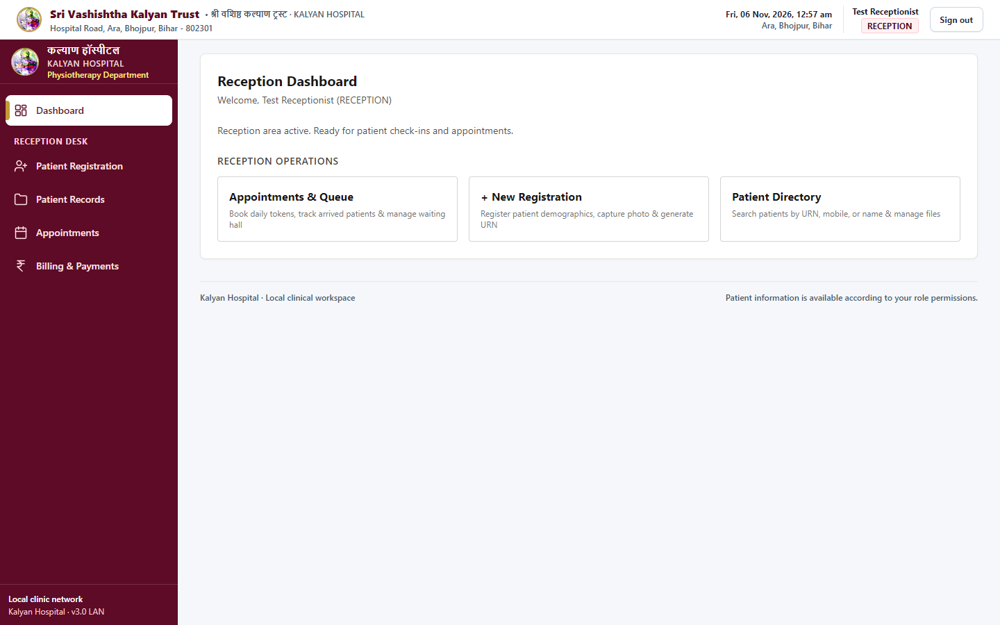 | 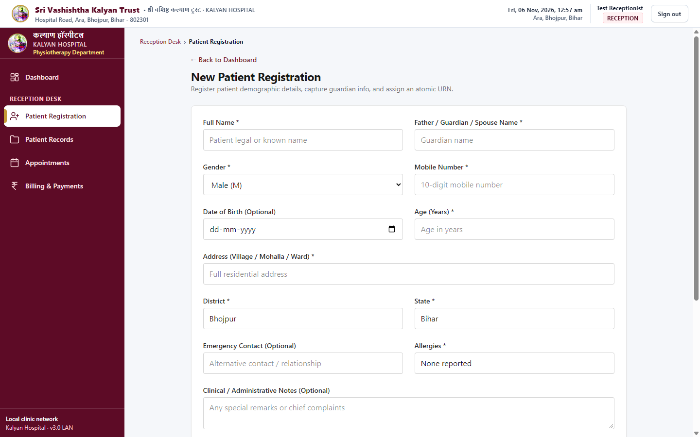 |
| **Real-time Queue & Appointments Desk** | **Patient Record Directory** |
| 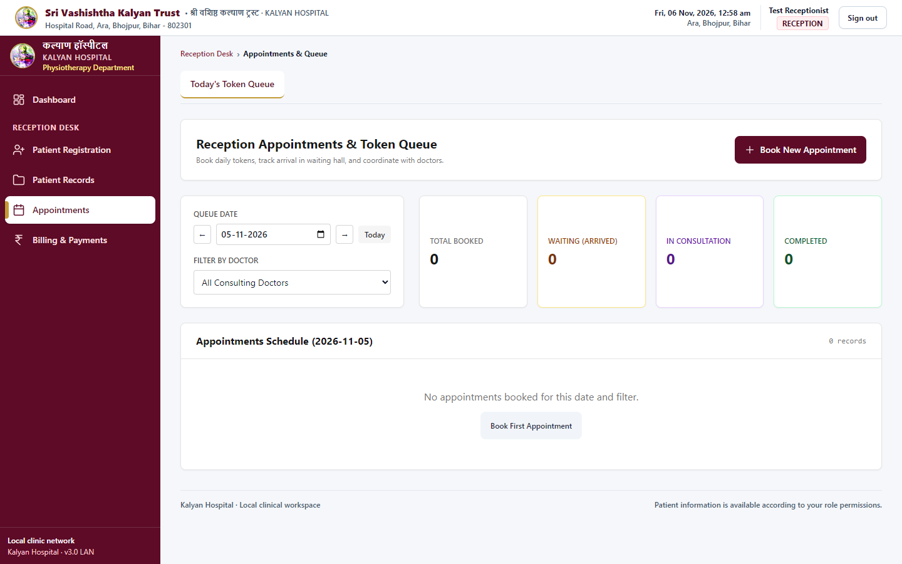 | 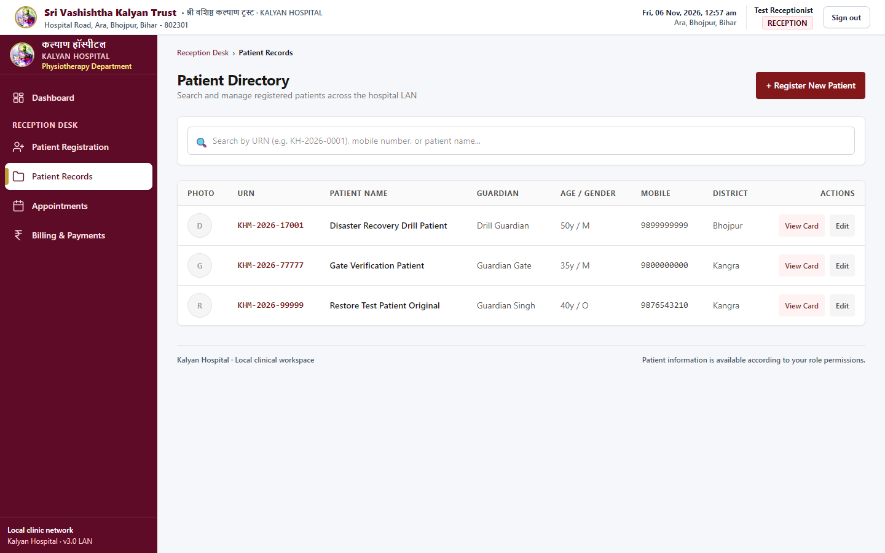 |

---

### 2. Clinical Encounter & Doctor Workspace
Integrated encounter notes, vitals monitoring with automated BMI, versioned clinical specialty templates, and standardized prescription generation.

| Universal Clinical Encounter Workspace | Prescription & Treatment Plan Authoring |
| :---: | :---: |
| 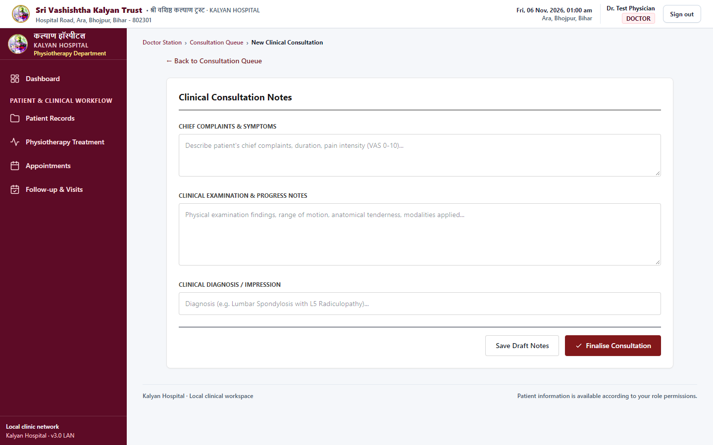 | 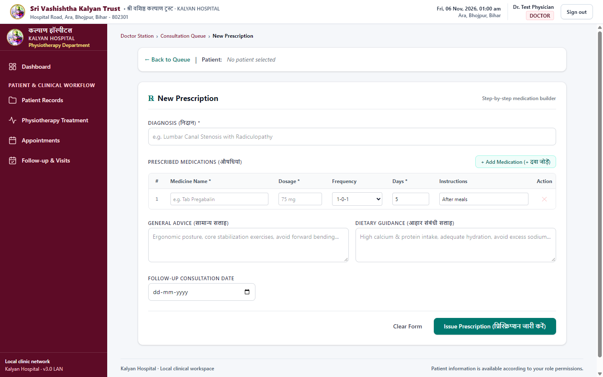 |
| **Doctor Overview & Pending Arrivals** | **Physiotherapy & Rehab Packages** |
| 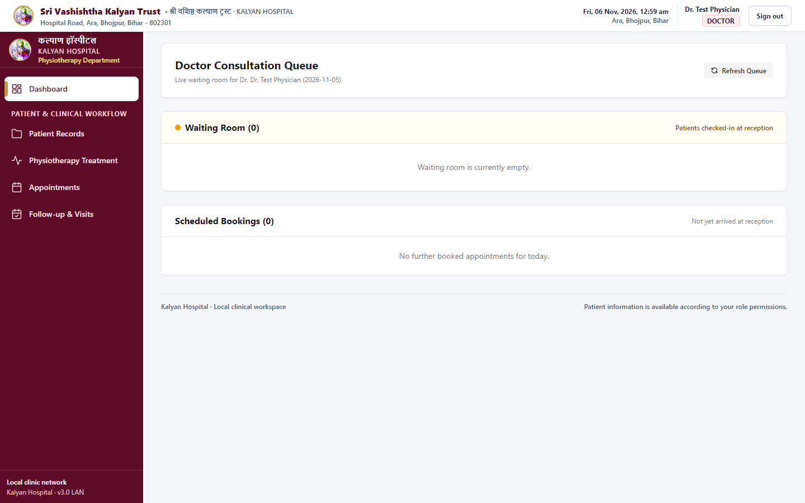 | 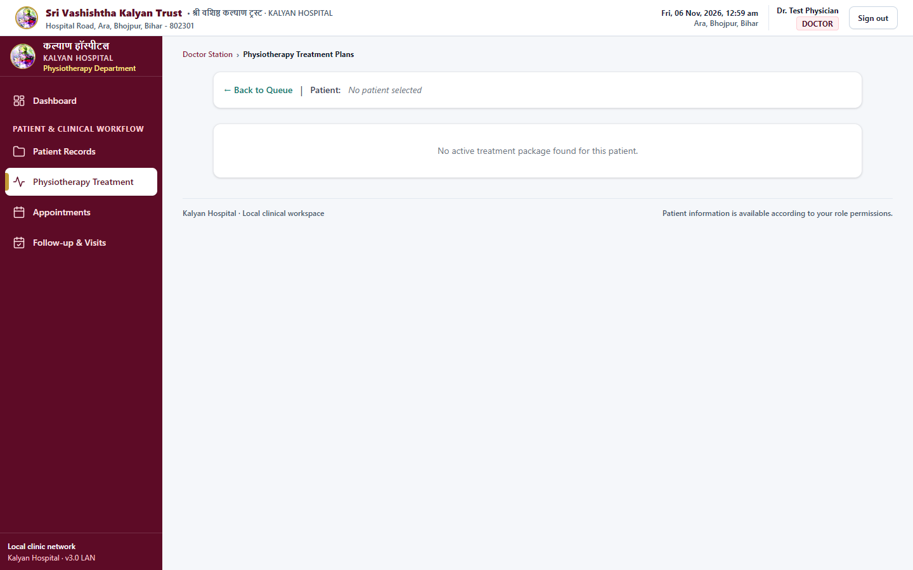 |

---

### 3. Administration, Financial Governance & Security
Full operational visibility, integer-paise financial ledger, role-based access control, cryptographic audit trail, and zero-data-loss database backups.

| Executive Operations Dashboard | Financial Ledger & Fee Configurations |
| :---: | :---: |
|  | 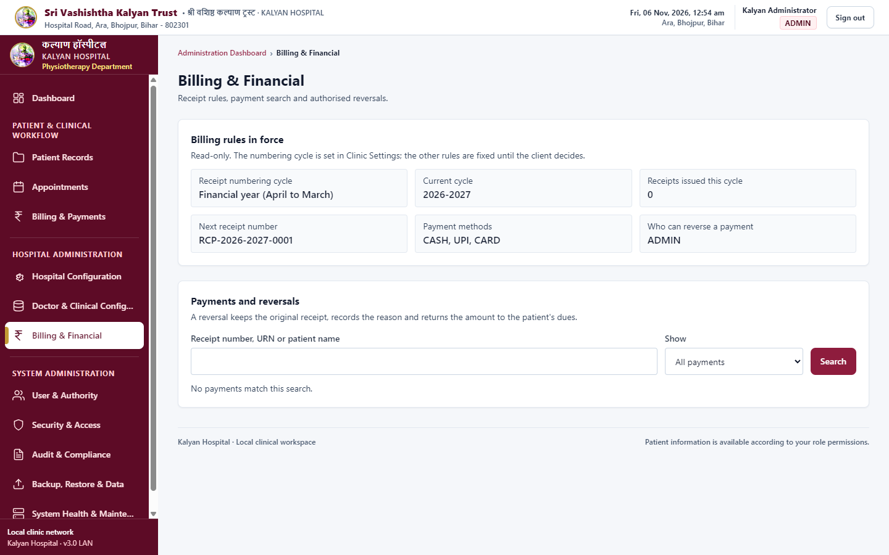 |
| **Immutable Cryptographic Audit Trail** | **Automated Local Database Backups** |
| 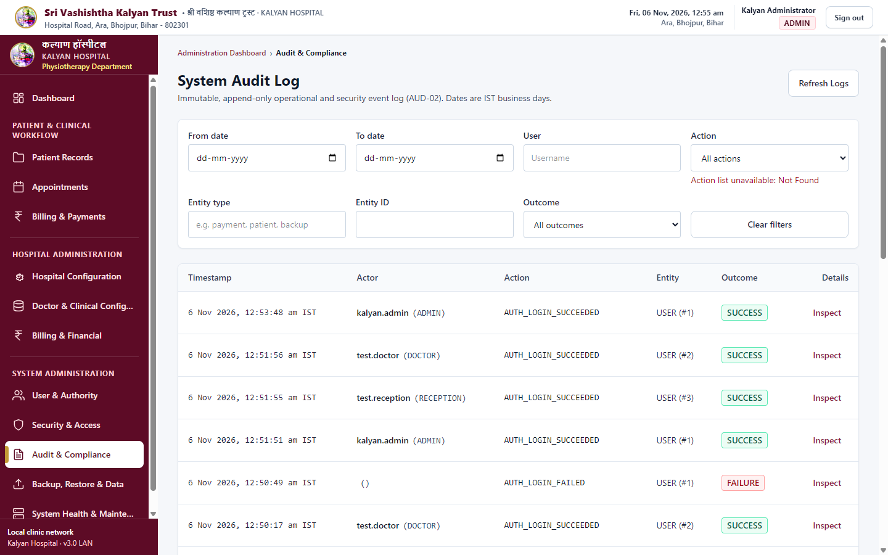 | 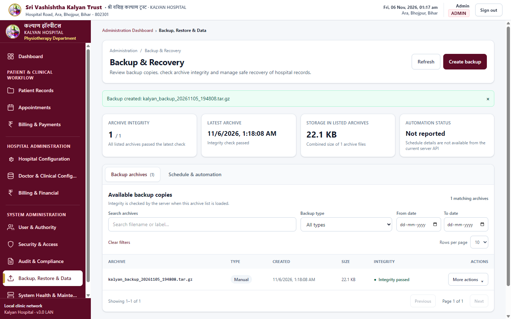 |

---

## Key Features

### 🏥 Reception & Front Desk Intake
- **Universal Permanent URN:** Patients receive a lifetime unique registration number valid across all specialties and visits.
- **Smart Patient Directory:** Fast search by URN, name, or phone number with Devanagari and English phonetic matching.
- **Single-Step Token & Check-In Desk:** Automatically generates sequential daily tokens per doctor queue; supports Emergency, Priority, and Normal tiers with visual doctor alerts.
- **Photo Capture:** Web-standard camera integration for patient identity verification with client-side blob preview and server-side private storage.

### 🩺 Doctor Consultation & Clinical Encounter
- **Live Waiting Queue:** Real-time visibility into arrived, waiting, and in-consultation patients with visit reassignment capabilities.
- **Auto-Saving Clinical Workspace:** Debounced drafts prevent data loss on unexpected terminal disconnections or power drops.
- **Specialty Templates:** Dynamic, versioned clinical forms (General OPD, Ophthalmology, Physiotherapy, Orthopedics).
- **Vitals & Rx Pad:** Automatic BMI calculation, vitals alerts, drug catalog with dosage and frequency pickers, and dated clinical addenda.

### 🏋️ Physiotherapy & Rehabilitation
- **Session Tracking:** Multi-day treatment packages with automatic balance decrementing strictly upon verified session completion.
- **VAS Pain Scale Monitoring:** Longitudinal tracking of patient recovery metrics and session histories.

### 💳 Financial Ledger & Billing Desk
- **Separation of Duties:** Reception owns routine collection (`payment:create`); doctors cannot collect fees independently; administrators authorize fee adjustments and reversals with mandatory written justification.
- **Integer-Paise Precision:** Guaranteed exact monetary mathematics eliminating IEEE-754 floating-point rounding errors.
- **Immutable Financial Ledger:** Payments are append-only. No silent updates or ledger overwrites. Previous dues are segregated and tracked permanently across visits.
- **Bilingual Receipts:** Instant printable receipts with duplicate indicators and hospital crest branding.

### 🛡️ Enterprise Administration & Security
- **Strict Role-Based Access Control (RBAC):** Server-side authorization enforced on every endpoint for `Admin`, `Reception`, and `Doctor` roles.
- **Cryptographic Password Security:** Argon2id password hashing with mandatory first-login password rotation.
- **First-Run Console Bootstrap:** Ephemeral, cryptographically secure one-time token printed exclusively to the server terminal to initialize the first administrator.
- **Immutable Audit Log:** Structured event recording tracking actor, IP, timestamp, action, and before/after diffs across all clinical, financial, and administrative operations.
- **Zero-Internet Backup & Restore:** Automated scheduled database snapshots with pre-restore integrity validation.

---

## Hospital Business Invariants

The platform strictly enforces the following core business and clinical invariants across all layers:

| # | Business Invariant | Technical Enforcement |
|:---:|:---|:---|
| **1** | **One Permanent URN** | Unique constraint per patient record across all hospital departments. |
| **2** | **Multiple Visits per Patient** | Relational hierarchy: Patient $\rightarrow$ Visits $\rightarrow$ Encounters. |
| **3** | **Independent Doctor Queues** | Daily monotonic token sequence keyed by `(doctor_id, date)`. |
| **4** | **Queue & Visit Affinity** | Queue entries belong strictly to verified visits and assigned clinicians. |
| **5** | **Separation of Duties** | Reception collects routine fees; Doctors have zero collection permissions. |
| **6** | **Fee Adjustment Authorization** | Concessions and fee waivers require recorded doctor authorization. |
| **7** | **Integer Paise Ledger** | All currency stored as integer paise (1 INR = 100 paise) preventing rounding defects. |
| **8** | **Non-Destructive Financials** | Payments are strictly append-only; reversals require Admin authorization and reason. |
| **9** | **Physiotherapy Deductions** | Package sessions decrement only upon clinical completion marker. |
| **10** | **Offline LAN Operation** | Zero third-party cloud CDNs, telemetry, or remote auth dependencies. |

---

## System Architecture

```mermaid
flowchart TD
    subgraph Client Workstations (LAN Web Browsers)
        R[Reception Desk<br>Token & Intake]
        D1[Doctor Cabin 1<br>OPD Consultation]
        D2[Doctor Cabin 2<br>Rehabilitation]
        A[Admin Terminal<br>Governance & Audit]
    end

    subgraph Central LAN Host Server
        LB[FastAPI Gateway / Security Middleware]
        SEC[Auth & Session Manager<br>Argon2id + RBAC]
        BL[Business & Clinical Logic<br>OPD, Encounters, Billing]
        DB[(Central PostgreSQL 16<br>Relational Integrity)]
        FS[(Local File Storage<br>Patient Photos & Docs)]
        AUD[(Immutable Audit Trail<br>Security Events)]
    end

    R -->|HTTP / JSON API| LB
    D1 -->|HTTP / JSON API| LB
    D2 -->|HTTP / JSON API| LB
    A -->|HTTP / JSON API| LB

    LB --> SEC
    SEC --> BL
    BL --> DB
    BL --> FS
    BL --> AUD
```

---

## Technology Stack

```
Frontend:
├── Framework: React 19 (React Router 8, Strict Mode)
├── Language: TypeScript 7
├── Build Tool: Vite 8 (Hot Module Replacement, Bundler)
├── Styling: Tailwind CSS v4
├── State & Server Cache: TanStack Query v5
└── Icons: Tabler Icons React

Backend:
├── Framework: FastAPI 0.162 (Asynchronous ASGI Server)
├── Language: Python 3.12+
├── ORM & Migrations: SQLAlchemy 2.0 + Alembic
├── Runtime Server: Uvicorn (Optimized Worker Architecture)
├── Cryptography: Argon2id (Passlib / Argon2-cffi)
└── Validation: Pydantic v2

Database & Storage:
├── Primary Database: PostgreSQL 16 (LAN Central Server)
├── Integrity: Row-Level Locking, Check Constraints, Relational Foreign Keys
└── Document Store: Server-Side Opaque File Storage with Path Traversal Prevention
```

---

## Quickstart & Installation

### Prerequisites
- **Python:** 3.12 or newer
- **Node.js:** 22.x LTS or newer
- **PostgreSQL:** 16.x installed on the central server machine
- **Network:** Connected Local Area Network (LAN) router or switch

### 1. Database Setup
Create the central hospital database:
```sql
CREATE DATABASE hospital_opd;
CREATE USER opd_user WITH ENCRYPTED PASSWORD 'secure_password';
GRANT ALL PRIVILEGES ON DATABASE hospital_opd TO opd_user;
```

### 2. Backend Setup
```powershell
# Navigate to backend directory
cd backend

# Create and activate Python virtual environment
python -m venv .venv
.\.venv\Scripts\Activate.ps1

# Install dependencies
pip install -e .

# Configure environment variables (.env)
Copy-Item .env.example .env
# Edit .env with your PostgreSQL database URL

# Apply database migrations
alembic upgrade head

# Start API service
python -m uvicorn kalyan_api.main:create_app --factory --host 0.0.0.0 --port 8000
```

### 3. Frontend Setup (Development Mode)
```powershell
# Navigate to frontend directory
cd frontend

# Install dependencies
npm install

# Start Vite dev server with Hot Module Replacement
npm run dev
```
Open **`http://localhost:5173`** in your browser to access the live development workspace.

### 4. Production Build & Deployment
For production hospital LAN deployment, build the frontend static distribution:
```powershell
cd frontend
npm run build
```
The central FastAPI service automatically serves the compiled Single Page Application from `frontend/dist` on `http://<SERVER-LAN-IP>:8000` to all client workstations.

---

## First Administrator Setup Wizard

To guarantee maximum security out of the box, **the platform has zero default credentials**.

```
======================================================================
  HOSPITAL OPD PLATFORM — FIRST-RUN SETUP
  One-Time Setup Token: [ 8b3f-e9a1-42cd-9f70 ]
  Valid for 15 minutes. Enter this token in the browser at:
  http://localhost:8000/ to create the initial Administrator account.
======================================================================
```

1. Upon fresh database initialization, the server generates a cryptographically random, ephemeral one-time setup code printed only to the physical server console.
2. Opening `http://localhost:8000/` loads the bootstrap wizard where the administrator enters the console code, username, and master password.
3. Once the administrator is created, the setup endpoint is permanently disabled.

---

## Automated Verification & Test Coverage

The platform is fortified by automated unit, integration, guard, and end-to-end regression test suites:

- **Backend Pytest Suite:** 1,390+ automated tests across 78 test modules covering RBAC security, API contracts, fee calculations, and database transactions.
  ```powershell
  cd backend
  pytest tests
  ```
- **Frontend Vitest Suite:** 500+ tests spanning 75 test suites verifying component rendering, user interactions, accessible names, and UI guards.
  ```powershell
  cd frontend
  npm run test
  ```
- **End-to-End Clinical Lifecycle Verification:** Comprehensive automated rehearsal simulating full multi-department patient journeys (Intake $\rightarrow$ Token Desk $\rightarrow$ Consultation $\rightarrow$ Prescription $\rightarrow$ Billing $\rightarrow$ Receipt Generation).

---

## Security & Compliance

See [SECURITY.md](SECURITY.md) for detailed information on:
- Coordinated Vulnerability Disclosure Process
- Air-Gapped Local Area Network Threat Model
- Authoritative Role-Based Access Control (RBAC) Matrix
- Sensitive File and Patient Asset Protections
- Tamper-Evident Database Backup and Restoration Protocols

---

## License

This software and its documentation are proprietary hospital clinical management software. All rights reserved.
