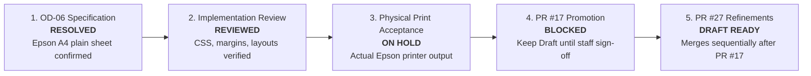

# Operational Acceptance Matrix & Release Readiness Protocol

> **Document Status:** Active / Operational Release Readiness Protocol  
> **PR #17 (Foundation):** [PR #17](https://github.com/aayushsharma141/dr-sr/pull/17) (`feature/reception-all-specialties`) — **Head:** [`14b7f14`](https://github.com/aayushsharma141/dr-sr/commit/14b7f14) — **CI:** 🟢 Green (3/3 jobs) — **Gate:** 🛑 **Draft (Awaiting physical printer walkthrough)**  
> **PR #27 (Refinements):** [PR #27](https://github.com/aayushsharma141/dr-sr/pull/27) (`feature/reception-refinements`) — **Head:** [`ccdbdfb`](https://github.com/aayushsharma141/dr-sr/commit/ccdbdfb) — **CI:** 🟢 Green (3/3 jobs) — **Base:** `feature/reception-all-specialties`  

---

## 1. Distinct Release Gate Pipeline

To prevent premature release, the project tracks four discrete, non-fungible gates:

| Release Gate | Level | Status | Criteria for Transition |
| :--- | :--- | :--- | :--- |
| **1. OD-06 Specification** | Architectural Spec | 🟢 **RESOLVED** | Epson A4 desktop printer & plain A4 sheet paper confirmed (no thermal). |
| **2. Implementation Review** | Source Code Audit | 🟢 **REVIEWED** | 12mm `@media print` margins, digital letterhead, and solid `DUPLICATE` stamp verified. All 5 PR #17 review threads resolved. |
| **3. Physical Print Acceptance** | Hardware Inspection | ⏸️ **ON HOLD** | Physical printouts inspected on-site for margins, no second blank page, and long text. Conducted when hospital staff convenes. |
| **4. PR #17 Promotion** | Release Governance | 🔴 **BLOCKED** | Retain Draft status on GitHub until all nine formal UAT scenarios (UAT-01 through UAT-09) and physical print checks pass. |
| **5. PR #27 Refinements Promotion** | Refinement Track | 🟡 **DRAFT OPEN** | Opened as PR #27 against PR #17. Merges sequentially once PR #17 completes Gate 3. |

---

## 2. Locked Physical Print Acceptance Matrix (Epson A4 Plain Sheet)

All physical print tests must be conducted directly on the hospital's Epson A4 printer under standard conditions:

> [!IMPORTANT]
> **Print Driver Settings for Verification:**
> - **Scale:** Must be set to **Actual Size / 100%** (never "Fit to Page" or "Shrink to Fit").
> - **Margins:** 12 mm margins confirmed on all 4 borders.
> - **Page Count:** Zero blank second pages ejected.
> - **Color/Mode:** Standard black/grayscale output confirmed legible on normal inkjet paper.

| Document | Physical Inspection Criteria | Boundary / Stress Checks | Result |
| :--- | :--- | :--- | :--- |
| **Patient Registration Card** | • A4 portrait orientation. • Full hospital header with Hindi & English titles. • Patient URN barcode & alphanumeric string clear. • 12 demographic fields properly aligned. • Signature block positioned at bottom. | Test with **long name and multi-line address**: • Name: *"Dr. Birendra Kumar Upadhyay Choudhary"* • Address: *"Village & Post Rampur, Ward No. 12, Near Shiv Mandir, Sandesh, Bhojpur - 802164"* Assert no text truncation or line overlap. | `[ ] PASS` `[ ] FAIL` `[ ] NOT TESTED` |
| **OPD Payment Receipt** | • Clean centered receipt layout on A4 plain sheet. • Official clinic header & contact numbers. • Receipt No, Date/Time, and Cashier `@username` legible. • Total Amount in INR (₹) bold and unambiguous. • Computer-generated disclaimer & bilingual blessing footer intact. | Test two copies: 1. **Original Copy:** Clean payment receipt. 2. **Reprint Copy:** Assert solid red bordered `DUPLICATE` stamp renders crisply without obscuring transaction figures. | `[ ] PASS` `[ ] FAIL` `[ ] NOT TESTED` |
| **Doctor Prescription Slip** | • Clinic letterhead and doctor registration details clear. • Adequate blank writing / clinical findings area. • Medication table lines render cleanly with column headers (Drug, Dosage, Frequency, Duration). • Doctor physical signature & seal line aligned. | Test bilingual rendering: • Ensure Hindi Devanagari instructions (e.g., *"दिन में दो बार भोजन के बाद"*) render with correct font glyphs without box artifacts (`□`). | `[ ] PASS` `[ ] FAIL` `[ ] NOT TESTED` |

---

## 3. Mandatory UAT Safeguards & Synthetic Data Policy

1. **Strictly Zero Real Patient Data:**
   - Under no circumstances will real patient health information (PHI) or live clinic records be entered during initial UAT.
   - All UAT scenarios must use synthetic dummy profiles (e.g., *"Test Patient Alpha"*, *"Demo Patient Beta"*).
2. **Individual Role Account Isolation:**
   - No shared logins or generic "admin" execution. Every participant logs into their designated role account:
     - Receptionist: `uat_reception`
     - Senior Doctor (Physiotherapy / General): `uat_dr_anil`
     - Specialist Doctor (Orthopaedics / Ayush): `uat_dr_bharati`
     - Hospital Administrator: `uat_admin`
3. **Three-Tier Backup & Disaster Recovery Validation:**
   - **Level 1: Automated Database Restore Integration Test** (🟢 **CI Verified**): Pipeline automated tests in `test_backup_restore.py` verify that `RUNTIME_TABLE_GRANTS` in `backup_service.py` cleanly restore `departments` and `doctor_departments` with correct role permissions.
   - **Level 2: Clean-Machine Deployment Package Restore Drill** (🟡 **Pending**): Windows staging rehearsal verifying that the offline deployment package restores cleanly on a virgin machine with zero pre-existing database state.
   - **Level 3: Hospital LAN Operational Disaster Recovery Drill** (🟡 **Pending — UAT-09**): On-site rehearsal where `uat_admin` triggers a backup, modifies a test record, executes restore, and proves data returns to the exact pre-alteration state on the clinic server.

---

## 4. Formal On-Site UAT Scorecard

To be completed on-site with physical evidence (signed test sheets / printouts attached):

| Test ID | Operational Scenario | Role Executing | Acceptance Criteria | Evidence Required | Score |
| :--- | :--- | :--- | :--- | :--- | :--- |
| **UAT-01** | **Patient Registration & Multi-Department Routing** | `uat_reception` | Register synthetic patient; route to *Physiotherapy* (Dr. Anil); verify Doctor dropdown filters strictly to assigned doctors; issue Token #1. | System screen & appointment card | `[ ] PASS` `[ ] FAIL` |
| **UAT-02** | **Independent Daily Token Allocation** | `uat_reception` | Register 2nd patient; route to *Orthopaedics* (Dr. Bharati) on same day; verify Doctor B independently receives Token #1. | Appointments table view | `[ ] PASS` `[ ] FAIL` |
| **UAT-03** | **Doctor Queue & Clinical Silo Isolation** | `uat_dr_anil` `uat_dr_bharati` | Dr. Anil logs in: sees only Patient 1. Dr. Bharati logs in: sees only Patient 2. Dr. Bharati attempts direct URL navigation to Patient 1 encounter: blocked with 404. | Browser error screen (404) | `[ ] PASS` `[ ] FAIL` |
| **UAT-04** | **Payment Collection & Receipt Issuance** | `uat_reception` | Collect ₹300 consultation fee for Patient 1; print receipt on Epson A4 printer. Assert Receipt # matches sequential ledger. | Physical Epson A4 printout | `[ ] PASS` `[ ] FAIL` |
| **UAT-05** | **Admin Payment Posting Block (Least Privilege)** | `uat_admin` | Log in as Admin: confirm no payment collection buttons exist; attempt direct API POST to `/api/payments`: blocked with HTTP 403. | UI observation / audit log | `[ ] PASS` `[ ] FAIL` |
| **UAT-06** | **Payment Reversal with Audit Justification** | `uat_admin` | In Billing Ledger, locate Receipt #1; click Reverse; enter required reason (≥ 5 chars); confirm receipt is marked REVERSED and ledger balance decrements. | Ledger screenshot | `[ ] PASS` `[ ] FAIL` |
| **UAT-07** | **Physical Duplicate Receipt Print** | `uat_reception` | Reprint reversed receipt; print on Epson A4 printer; confirm `DUPLICATE` stamp and `REVERSED` banner are legible. | Physical Epson A4 printout | `[ ] PASS` `[ ] FAIL` |
| **UAT-08** | **Prescription Slip Print** | `uat_dr_anil` | Issue prescription with bilingual advice; print on Epson A4 printer; inspect table grid and Devanagari text. | Physical Epson A4 printout | `[ ] PASS` `[ ] FAIL` |
| **UAT-09** | **Backup & Disaster Recovery Round-Trip** | `uat_admin` | Create backup `.tar.gz`; create dummy test department; execute restore drill; verify pre-restore snapshot exists and database returns to clean state with all permissions intact. | Admin Operations view | `[ ] PASS` `[ ] FAIL` |

---

## 5. Formal Client Acceptance Sign-Off

*Sign-off is strictly conditioned upon 100% `PASS` across all 9 operational scorecard items and inspection of physical Epson A4 print samples.*

- **Hospital Administrator Sign-off:**  
  Name: ___________________________ Signature: ___________________________ Date: ______________

- **Reception Lead Sign-off:**  
  Name: ___________________________ Signature: ___________________________ Date: ______________

- **Medical Superintendent / Senior Doctor Sign-off:**  
  Name: ___________________________ Signature: ___________________________ Date: ______________

---

## 6. Release Merge Procedure (Post Sign-Off Only)

1. Attach scanned copy of signed scorecard and physical print samples to PR [#17](https://github.com/aayushsharma141/dr-sr/pull/17).
2. Remove **Draft** status from PR #17 and request final review approval.
3. Merge PR #17 into `main`.
4. Tag release `v3.0.0-reception-specialties`.
5. Run PyInstaller offline Windows executable build and package LAN deployment zip.
