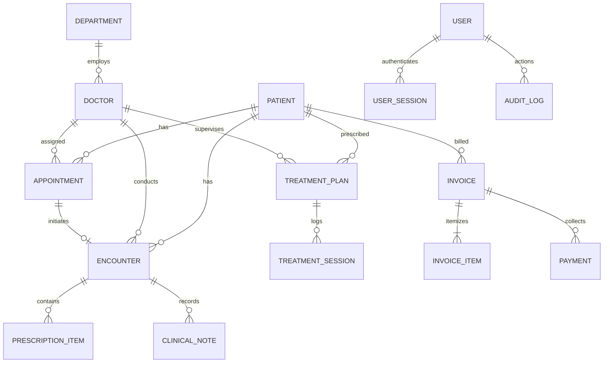

# Kalyan Hospital — Database Relational Model & Entity Lifecycle

## Relational Constraints & Invariants
1. **Permanent Patient Identity**: `patients.urn` is unique and immutable.
2. **Per-Doctor Daily Token**: `appointments(doctor_id, appointment_date, token_number)` is unique.
3. **Append-Only Auditing**: `audit_logs` has trigger protections rejecting updates and deletions.
4. **Finalized Clinical Locks**: `encounters.is_finalised` triggers read-only enforcement in PostgreSQL.
5. **Session Deduction Invariant**: `treatment_plans.completed_sessions` increments strictly when a `treatment_session` is completed.

