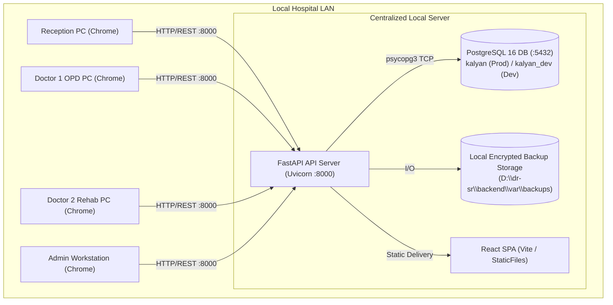

# Kalyan Hospital — System Architecture Specification

## 1. Physical & Network Topology

## 2. Invariants & Offline Guarantees
- Zero internet dependency for daily operations.
- Central local server holds the single source of truth.
- Local printing via browser print stylesheet targeting 80mm receipt printers and A4 prescription pads.
- Synchronized queue states across reception and doctor desks via HTTP polling / server-sent events.

