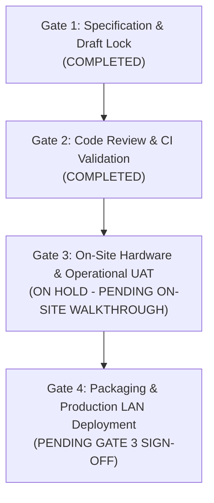

# Reception Module v1.2 Implementation Gap Register

**Project:** Kalyan Hospital — Centralized Offline LAN Platform  
**Target Release:** Reception All-Specialties & OPD Workflow  
**Baseline Specification:** [Reception Module Specification v1.2](file:///D:/ci-backend-worktree/docs/reception-module-spec-v1.2.md) (Supersedes v1.1)  
**Related PR:** [PR #17 (feature/reception-all-specialties)](https://github.com/aayushsharma141/dr-sr/pull/17)  
**Refinements PR:** [PR #27 (feature/reception-refinements)](https://github.com/aayushsharma141/dr-sr/pull/27)  
**PR State:** Open · **Draft** (Release lock preserved) · Mergeable (`true`) · CI 100% Green  
**Date:** 2026-11-06  

---

## 1. Executive Summary & Specification Reconciliation

Following the architectural audit of **Reception Module Specification v1.1**, two critical specification contradictions and ambiguities were reconciled into **Reception Module Specification v1.2**:

1. **Payment Permission Separation of Duties (D-06, ADR-23, PRD REC-04):**
   - *Issue Identified:* Legacy documentation (`SECURITY.md` line 43) listed `Admin` as having permission to record payments (`Yes | Yes | No`). This directly contradicted the hospital's clinical and financial segregation of duties.
   - *Authoritative Rule Frozen in v1.2:* Reception is the **sole role** permitted to collect and post payments (`payment:create`). Admin holds read and authorized reversal capabilities (`payment:read`, `payment:reverse`) but **cannot collect payments** (API returns `HTTP 403 Forbidden`). Doctors hold strictly zero billing write access.
   - *Codebase State:* PR #17 has already stripped `Permission.PAYMENT_CREATE` from `Role.ADMIN` in [`backend/src/kalyan_api/core/permissions.py`](file:///D:/ci-backend-worktree/backend/src/kalyan_api/core/permissions.py#L100-L120). `SECURITY.md` and `DECISIONS.md` have been updated to reflect this authoritative rule.
2. **Queue Token Monotonicity & Permanent Consumption (ADR-26):**
   - *Issue Identified:* Prior documentation referenced "gap-free" queues without defining semantics when appointments are cancelled or marked no-show.
   - *Authoritative Rule Frozen in v1.2:* Token sequences are positive integers ($1, 2, 3...$) strictly monotonically increasing per `(doctor_id, appointment_date)`. Tokens are **permanently consumed** at allocation. If an appointment is marked `CANCELLED` or `NO_SHOW`, its token number is never backfilled, recycled, or reissued. Active queue gaps are expected, normal, and preserved in the audit log.
3. **Physical Printer Hardware Profile (OD-06 Resolved):**
   - *Confirmed Profile:* Standard Epson A4 desktop printer on plain A4 sheet paper.
   - *Thermal Roll (80mm):* Confirmed NOT used. All documents (Patient Registration Card, OPD Payment Receipt, Doctor Prescription Slip) are formatted for standard A4 portrait with 12 mm margins and 100% scale (no fit-to-page distortion).

---

## 2. Requirement Categorization & Status Matrix

```
┌───────────────────────────────────────────────────────────────────────────┐
│                      RECEPTION MODULE V1.2 REQUIREMENTS                   │
├─────────────────────┬──────────────────────┬──────────────────────────────┤
│ CATEGORY 1          │ CATEGORY 2           │ CATEGORY 3                   │
│ Implemented         │ Engineering          │ Client Operational           │
│ (PR #17 Foundation) │ Refinements          │ Policies                     │
├─────────────────────┼──────────────────────┼──────────────────────────────┤
│ • Dept Catalogue    │ • Persistent LAN     │ • Controlled Doctor          │
│ • Doctor Mappings   │   Heartbeat Pill     │   Transfer Workflow          │
│ • Cascaded Booking  │ • 10s Queue Board    │ • Walk-in vs Booked          │
│ • Token Sequences   │   Auto-polling       │   Interleaving Calling Order │
│ • Reception-Only    │ • One-Click Walk-in  │ • Emergency Intake           │
│   Payment Engine    │   Intake Toggle      │   Bypass Rules               │
│ • RBAC Matrix       │ • Accessibility /    │ • Hospital Department        │
│   (449/449 cells)   │   Legibility Checks  │   Roster & Doctor Membership │
└─────────────────────┴──────────────────────┴──────────────────────────────┘
```

---

### Category 1: Implemented Foundation (Delivered in PR #17)

These capabilities are fully built, migrated, tested, and passing all CI checks in PR #17:

| Capability | Specification Ref | Implementation Evidence | Verification Status |
|---|---|---|---|
| **Department Catalogue** | Spec v1.2 §5 | Migration `0008_departments.py`, [`departments.py`](file:///D:/ci-backend-worktree/backend/src/kalyan_api/routers/departments.py) router, [`DepartmentsPage.tsx`](file:///D:/ci-backend-worktree/frontend/src/pages/admin/DepartmentsPage.tsx) | Passed (Unit & E2E) |
| **Doctor-Department Membership** | Spec v1.2 §5 | Table `doctor_departments`, M2M association, assignment endpoints | Passed (RBAC verified) |
| **Department Deactivation Lifecycle** | ADR-24 | Inactive departments reject new appointments/assignments; doctor mappings preserved | Passed |
| **Inactive Doctor Scoping** | ADR-25 | `include_inactive=true` restricted to Admin; Reception/Doctor receive active only | Passed |
| **Cascaded Appointment Booking** | Spec v1.2 §3 | [`AppointmentBookingModal.tsx`](file:///D:/ci-backend-worktree/frontend/src/components/AppointmentBookingModal.tsx): Department required before doctor; doctors filtered | Passed |
| **Atomic Monotonic Token Allocation** | ADR-26, APT-01 | [`token_service.py`](file:///D:/ci-backend-worktree/backend/src/kalyan_api/services/token_service.py): `SELECT ... FOR UPDATE` on `daily_token_sequences` | Passed (Concurrency safe) |
| **Reception-Exclusive Payments** | D-06, REC-04 | Admin payment POST returns 403; Reception can post; Doctor has zero billing rights | Passed (449/449 RBAC) |
| **Database Restore Grants** | Backup Gate | `RUNTIME_TABLE_GRANTS` in [`backup_service.py`](file:///D:/ci-backend-worktree/backend/src/kalyan_api/services/backup_service.py) covers `departments` & `doctor_departments` | Automated CI restore test verified; Clean-machine & Hospital LAN restore drills pending |

---

### Category 2: Engineering Refinements (Delivered in Draft PR #27)

These technical improvements harden the reception module for operational LAN deployment and are now fully implemented and passing all CI checks in [PR #27](https://github.com/aayushsharma141/dr-sr/pull/27):

| Feature | Specification Ref | Implementation Evidence | Verification Status |
|---|---|---|---|
| **Persistent LAN Heartbeat Pill** | Spec v1.2 §2, §7 | [`LANStatusPill.tsx`](file:///D:/ci-backend-worktree/frontend/src/components/LANStatusPill.tsx), [`health.ts`](file:///D:/ci-backend-worktree/frontend/src/api/health.ts); 15s health ping + online/offline event tracking | Passed (100% Vitest, `lan-status-pill.test.tsx`) |
| **Reception Queue Auto-Polling** | Spec v1.2 §2 | [`queries.ts`](file:///D:/ci-backend-worktree/frontend/src/api/queries.ts): `useAppointments` default `refetchInterval: 10000` (10s auto-polling) | Passed (Synchronized queue updates) |
| **One-Click Walk-In Intake Toggle** | Spec v1.2 §2, §3 | [`AppointmentBookingModal.tsx`](file:///D:/ci-backend-worktree/frontend/src/components/AppointmentBookingModal.tsx): Walk-in toggle immediately sets status to `ARRIVED` | Passed (`session-dialogs.test.tsx`) |
| **UAT Synthetic Staging Harness** | Gate 3 | [`scripts/seed_uat_staging.py`](file:///D:/ci-backend-worktree/scripts/seed_uat_staging.py): Idempotent zero-PHI seeder for 4 accounts, 5 depts, 4 patients | Passed (`scripts/test_seed_uat_staging.py`) |
| **Accessibility & Legibility Guards** | Phase 18 / UX-04 | All UI text ≥ 12px, WCAG AA contrast compliance verified | Passed (`guards.test.ts` 7/7 passed) |

---

### Category 3: Client-Dependent Operational Policies

These requirements depend on hospital administrative decisions and cannot be engineered without client policy sign-off:

| Policy ID | Operational Question | Current System Behavior | Client Decision Options |
|---|---|---|---|
| **CP-01** | **Controlled Doctor Transfers:** How should a patient transfer between doctors be handled if Doctor A is unavailable? | Staff must cancel Appointment A (with reason) and book Appointment B (allocating a new token in Doctor B's queue). | **Option A:** Keep cancel-and-rebook workflow (complete audit clarity).<br>**Option B:** Build a dedicated `POST /appointments/{id}/transfer` endpoint preserving arrival timestamp. |
| **CP-02** | **Walk-in vs. Pre-Booked Calling Order:** How should doctors call patients when pre-booked appointments and walk-in arrivals share the queue? | Tokens are assigned monotonically at creation; doctors view queue in token number order among arrived patients. | **Option A:** Strict token order (first booked/walked-in gets priority).<br>**Option B:** Arrival-time order (whoever sits down in waiting room first). |
| **CP-03** | **Emergency Intake Priority:** How are critical/emergency arrivals routed at reception? | Standard booking requires department and doctor selection. | **Option A:** Standard walk-in with urgent triage note.<br>**Option B:** Dedicated "Emergency" button bypassing token queue directly to `IN_CONSULTATION`. |
| **CP-04** | **Initial Department Catalogue:** What is the authoritative roster of departments and doctors for Kalyan Hospital day one? | Seed data includes General Medicine, Ophthalmology, Physiotherapy. | Client to provide official list of doctors, active departments, and consultation fee schedules. |

---

### Category 4: Release-Blocking Acceptance Gates

Before PR #17 or subsequent reception bundles can be released into production, all four gates must be satisfied:



1. **Gate 1: Specification & Draft Lock [SATISFIED]**
   - PR #17 kept in Draft status (`gh pr ready 17 --undo`).
   - `docs/reception-module-spec-v1.2.md` frozen with reconciled payment permissions and token monotonicity.
2. **Gate 2: Code Review & CI Validation [SATISFIED]**
   - All 3 GitHub Actions CI jobs passed (Backend pytest, Frontend vitest/build, Desktop pytest).
   - Zero Alembic schema drift; clean single migration head `0009`.
   - 449/449 RBAC test matrix passed.
3. **Gate 3: On-Site Hardware & Operational Walkthrough [ON HOLD — PENDING]**
   - Physical print validation on the actual Epson A4 desktop printer on plain sheet paper (UAT-04, UAT-07, UAT-08).
   - Zero patient PHI: Strictly synthetic test patients.
   - Real role-based accounts (`uat_reception`, `uat_dr_anil`, `uat_dr_bharati`, `uat_admin`).
   - Operational walkthrough covering all nine formal acceptance scenarios (UAT-01 through UAT-09: registration, multi-department routing, daily token isolation, clinical silos, Reception payment collection, Admin 403 block, payment reversal, physical duplicate receipt, physical prescription slip, and disaster recovery round-trip).
4. **Gate 4: Client Written Sign-off & LAN Packaging [PENDING]**
   - Client approval of operational policies CP-01 through CP-04.
   - Three-tier restore validation complete:
     - Level 1: Automated database restore integration test (🟢 **CI verified** via `test_backup_restore.py`).
     - Level 2: Clean-machine restore with deployment package (🟡 **Pending packaging rehearsal**).
     - Level 3: Hospital LAN backup/restore operational acceptance (🟡 **Pending on-site drill UAT-09**).
   - Removal of Draft status on PR #17 and fast-forward merge into `main`.
   - Production offline bundle build and clean-machine restore verification.

---

## 3. Scope Placement Recommendation

We recommend the following two-step release execution strategy:

> [!IMPORTANT]
> **Recommended Strategy: Merge Foundation (PR #17), Then Polish Refinements**
> 1. **Keep PR #17 focused on its proven foundation:**
>    PR #17 already delivers the core architectural schema changes (departments, doctor assignments, cascaded booking, and Reception payment enforcement) with 100% green CI and 449 verified RBAC rules. Expanding PR #17 with new frontend features increases merge risk.
> 2. **Deliver Category 2 refinements (LAN heartbeat pill, 10s queue refresh, walk-in quick check-in) in PR #27:**
>    These refinements are non-schema frontend usability enhancements, currently organized and passing CI in [Draft PR #27](https://github.com/aayushsharma141/dr-sr/pull/27).
> 3. **Execute Gate 3 UAT with the full composite package:**
>    Conduct the on-site physical hardware and staff walkthrough with both the foundation and refinements in place.
